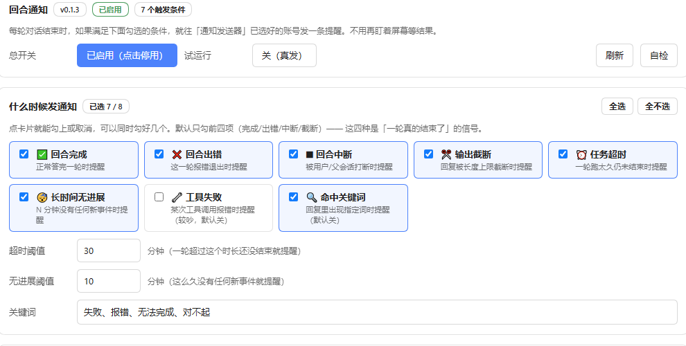

# dsh-turn-notify · 回合通知

> **一句话**：每一轮对话结束时，如果这一轮「答完了 / 报错了 / 被打断了 / 被截断了 / 跑太久 / 卡住了」，就往你在「通知发送器」里选好的 IM 账号推一条提醒——你可以去干别的，不用盯着屏幕等结果。
>
> **给谁用**：跑长任务的人（写代码、跑批处理、做数据分析、等 AI 干一堆活）。你发完一句就切走，手机响了再回来。
>
> **不解决什么**：它不是聊天机器人，**不收消息、不建立任何连接**；它也不替你判断「结果对不对」，只负责把「这一轮结束了」这件事告诉你。

---

## 界面截图



> 上图为真机实拍（本机 DSH 桌面版）。截图里的账号名、ID、发送记录已做像素化处理，只保留界面结构。

> 只想快点装起来？直接看根目录的 [INSTALL.txt](INSTALL.txt)：三步安装 + 三处验证 + 配置在哪 + 怎么卸。

---

## 目录

- [界面截图](#界面截图)
- [1. 零基础入门：三步就能用](#1-零基础入门三步就能用)
- [2. 界面逐项说明](#2-界面逐项说明)
  - [2.1 顶部状态条](#21-顶部状态条)
  - [2.2 什么时候发通知（9 个回合触发 + 1 个回合结算 + 4 个数值变化）](#22-什么时候发通知9-个回合触发--1-个回合结算--4-个数值变化)
  - [2.3 余额 API Key（可填多个）](#23-余额-api-key可填多个)
  - [2.4 发给谁](#24-发给谁)
  - [2.5 什么时候不发（防止吵）](#25-什么时候不发防止吵)
  - [2.6 运行情况与自检](#26-运行情况与自检)
  - [2.7 最近的发送记录](#27-最近的发送记录)
  - [2.8 界面挂在哪几个位置](#28-界面挂在哪几个位置)
- [3. 四个完整操作示例](#3-四个完整操作示例)
- [4. 配置文件详解](#4-配置文件详解)
- [5. 工作原理（技术参考）](#5-工作原理技术参考)
- [6. 排错手册](#6-排错手册)
- [7. FAQ](#7-faq)
- [8. 版本更新简介](#8-版本更新简介)
- [9. 已知限制与安全说明](#9-已知限制与安全说明)
- [10. 目录结构 / 开发 / 回归测试 / 许可](#10-目录结构--开发--回归测试--许可)

---

## 1. 零基础入门：三步就能用

### 第 1 步：确认「通知发送器」已经能用

打开 DSH → 设置 → **通知发送器**，随便发一条测试通知。
**能收到**，说明地基是好的，可以继续。**收不到**就先修它——本插件的所有消息都是借它的手发出去的。

> 为什么要先做这一步：回合通知自己不存任何账号、不存任何凭据。它只是「到点提醒一声」，真正把字发到你手机上的，是通知发送器。

### 第 2 步：确认本插件是开着的

打开 DSH → 设置 → **回合通知**（或左侧栏的「回合通知」整页）。
看到顶部的 `已启用` 绿色标签，就说明它在跑了。

第一次进来你会看到默认配置：

| 项 | 默认值 | 含义 |
|---|---|---|
| 总开关 | 已启用 | 关掉它 = 完全不处理事件 |
| 试运行 | 关（真发） | 打开后只记录不真发，用来先看「本该发什么」 |
| 触发条件 | 勾了前四项 + 第 9 项 | ✅ 回合完成 / ❌ 回合出错 / ⏹ 回合中断 / ✂️ 输出截断 / ❓ 等你回答问题 |
| 发给谁 | 跟随通知发送器 | 通知发送器选哪几个账号，这里就发给哪几个 |

### 第 3 步：发一条测试，然后就不用管了

点 **发一条测试通知**。手机响了 = 整条链路通了。
之后你正常跟 AI 对话，这一轮结束时就会自动收到一条，长得像这样：

```
【✅ DSH 回合通知：回合完成】
✅ 回合完成
会话：重构 watcher.js
会话 ID：34765d46
工作区：<插件根目录>\dsh-turn-notify
本轮耗时：4 分 12 秒
工具调用：23 次（失败 1 次）

最后一段回复：
已经把三个 bug 都修掉了，回归全部通过……

时间：2026-11-21 00:42:07
```

Agent 弹提问等你回答时，收到的那条长这样（**题目与所有选项都会列出来，推荐项前面打 ⭐**）：

```
【❓ DSH 回合通知：等你回答问题】
❓ 等你回答问题
会话：给 README 补一节说明
会话 ID：34765d46
工作区：<插件根目录>\dsh-turn-notify
说明：Agent 在等你回答 1 个问题（共 3 个选项），推荐：现在就跑（推荐）

第 1 题：要现在跑一遍全量回归吗？
  ⭐ [1] 现在就跑（推荐） —— 大约 20 秒
     [2] 等我先改完这一行再说
     [3] 先别跑，我只想看看代码

时间：2026-11-21 00:44:31
```

> 「等你回答问题」这条通知**只提醒，不代答**。它绝不替你选任何选项——推荐项那个 ⭐ 是**提问方自己标的**（很多 Agent 会把推荐项放第一位并在文案里写「（推荐）」），本插件只是把已有信息原样转给你。没标注就一个星都不打，绝不猜。

---

## 2. 界面逐项说明

界面分七块，从上到下依次是：顶部状态条 → 进度条 → 什么时候发 → 发给谁 → 什么时候不发 → 运行情况 → 发送记录。

### 2.1 顶部状态条

标题行右侧四个标签，一眼看清当前状态：

| 标签 | 含义 |
|---|---|
| `v0.1.9` | 插件版本（直接读 package.json，不手写，避免版本对不上） |
| `已启用` / `已停用` | 总开关状态。**停用时连事件都不处理**，不是「处理了但不发」 |
| `试运行` | 只在打开试运行时出现。此时会走完整个判定流程，但**不真发**，只写一条历史记录 |
| `回合 N / 9` | 九个「回合类」触发里勾了几个。0 个 = 回合结束永远不会发 |
| `变化 N / 3` | 三个「数值变化」触发里勾了几个。0 个 = 余额 / Token / 积分动了也不会提醒 |
| `N 个触发条件` | 九 + 三之外再把「本回合结算」算作 1 个。所以最大是 13 |

四个按钮：

- **总开关**：点击切换。改完立刻落盘，不需要「保存」。
- **试运行**：点击切换。第一次用建议先开它跑几轮，看看「本该发什么」，确认不吵了再关掉。
- **刷新**：重新拉一次配置、账号、统计、记录。
- **自检**：把「为什么没收到通知」的每一环摊开（详见 2.6）。

### 2.2 什么时候发通知（9 个回合触发 + 1 个回合结算 + 4 个数值变化）

这一块一共 **13 张卡片、17 个开关**，分成三类，判定方式完全不同：

| 类 | 个数 | 盯的是什么 | 什么时候响 |
|---|---|---|---|
| **回合类** | 9 | 一轮对话的「过程」和「结局」 | 有对话正在跑、且这一轮发生了某个事件 |
| **回合结算** | 1（内含 3 个小项） | 这一轮**自己**花了多少、余额和积分这一轮掉了多少 | 每轮结束时算一次，本轮确实有变化才发 |
| **数值变化** | 4 | 钱和额度的「绝对值」 | 跟哪一轮对话无关，数值比上次记下的值变化超过阈值就响 |

为什么必须分成两类：回合类的前提是「有一轮对话」，而余额、积分、Token 累计是**跨会话的账户级数字**——它们在凌晨三点、你没开任何对话的时候照样会变（比如后台签到、别的客户端在烧 Token）。硬塞进「回合结束」里就永远不会触发。

所有卡片点一下就开/关（左边是一个只读复选框，**点整张卡都能切**，不用精确点小方框）。

标题右侧有两个快捷键和一个计数：

| 按钮 | 作用 |
|---|---|
| **全选** | 九个**回合类**一次全勾上。想「什么都告诉我」时用 |
| **全不选** | 九个回合类一次全取消。等于「回合通知一项都不发」，但仍可手动发测试通知 |
| `回合 5 / 9` + `变化 1 / 4` | 两个计数芯片。分别数回合类与变化类；回合类勾满 9 项时变绿，0 项时是灰的 |
| `N 个触发条件` | 最右边的总数芯片：回合类 + 变化类 + 结算（开了算 1，没开算 0） |

> 这两个按钮是给「懒得一个个点」准备的，不会改动别的设置——点「全不选」后再点「全选」，回到的就是默认九个回合类全开，不是恢复你先前的组合。

> **全选 / 全不选既不碰那四个「数值变化」，也不碰「本回合结算」。** 这是故意的：它们一开启就会**对外发起 HTTP 请求**（查 DeepSeek 余额、查 WorkBuddy 积分），属于「有外部副作用」的开关；而「本回合结算」更狠——它会让**每一轮**开始和结束各去查一次（v0.1.11 起是成对比较，请求量是老版的两倍）。都不能被一次「懒得点」顺手打开。想开就单独点那张卡。

**勾选是叠加的，不是互斥的。** 点「回合完成」再点「回合出错」，两张卡会**同时**亮着——九个回合类可以任意组合，不存在「只能选一个」（四个数值变化项与「本回合结算」是另外两组，互不影响）。如果你发现点一个掉一个，那是浏览器还挂着旧的前端代码：按一次 **Ctrl+R** 重新加载页面即可（详细信息见第 9 节「已知限制」）。

**回合类（9 个）**——都是「某一轮对话」里发生的事：

| # | 条件 | 触发时机 | 默认 | 什么时候该开 |
|---|---|---|---|---|
| 1 | ✅ 回合完成 | 正常答完一轮 | **开** | 永远开着。这是本插件的主用途 |
| 2 | ❌ 回合出错 | 这一轮报错退出 | **开** | 永远开着。出错最需要知道 |
| 3 | ⏹ 回合中断 | 被用户 / 父会话打断 | **开** | 你经常按 Esc 就不用开；它会告诉你「我停了」 |
| 4 | ✂️ 输出截断 | 回复撞到长度上限 | **开** | 长输出任务开着有用，否则回复被截了你不知道 |
| 5 | ⏰ 任务超时 | 一轮跑超过 N 分钟还没结束 | 关 | 跑长任务时开。默认阈值 30 分钟 |
| 6 | 😴 长时间无进展 | N 分钟没有任何新事件 | 关 | 最容易卡住的任务（联网、调外部 API）值得开。默认 10 分钟 |
| 7 | 🔧 工具失败 | 某次工具调用返回 isError | 关 | **比较吵**：一个回合里失败三次就发三条。调试期开，平时关 |
| 8 | 🔍 命中关键词 | 回复里出现你指定的词 | 关 | 想让「失败/报错/对不起」这类词单独提醒时开 |
| 9 | ❓ 等你回答问题 | Agent 弹出提问、等你选的时候 | **开** | **建议一直开着**。这类等待是最容易「人在旁边干看着、其实机器早就在等你点」的 |

前四项的共同点：**都是一轮「真的结束了」的信号**。第 9 项不一样——它不是「结束了」，而是「卡在等你」。第 5–8 项是「过程信号」，所以默认关：不是它们没用，是它们会重复响。

第 9 项为什么默认开：一轮对话结束你至少知道「该看结果了」，而 Agent 提问时它**什么都不做、就那么等你**，你不盯着屏幕就完全不知道。这条通知里会把题目和全部选项都列出来，推荐项前面打 ⭐，你在手机上就能决定要不要去点。

勾了 5 会多出一行 **超时阈值**（1–720 分钟）；勾了 6 会多出一行 **无进展阈值**（1–720 分钟）；勾了 8 会多出 **关键词** 输入框（用中文顿号或逗号分隔，默认 `失败、报错、无法完成、对不起`）；勾了 9 会在下面多出两行说明文字（这一项没有可调的数值）。

> **超时和无进展的区别**：超时是「从头算，跑了 N 分钟还没完」；无进展是「最近 N 分钟一个新事件都没有」。前者抓「慢」，后者抓「死」。两个可以同时开。

#### 每回合结算（1 个主开关 + 3 个小项）

这一组排在回合类和数值变化之间，回答的是另一个问题：**「这一轮，到底花了多少？」**

数值变化回答的是「账户现在剩多少」，它跟具体哪一轮无关；结算回答的是「刚才这一轮消耗了多少、余额和积分在这一轮里掉了多少」。两者互相独立，可以只开一个，也可以都开。

| 项 | 作用 | 默认 | 要不要开 |
|---|---|---|---|
| 🧾 **本回合结算** | 总开关。打开后每轮结束算一次，有内容才发一条「🧾 本回合结算」 | 关 | 想知道「每轮成本」就开 |
| 🧮 结算含 Token 用量 | 写一行「本轮用了 X 个（本机累计 Y 个）」 | **开** | 零联网、零副作用，开着没成本 |
| 💰 结算含余额变化 | **回合开始与结束各查一次**，写「总额 / 充值余额 / 赠金余额」三行，每行都是「回合前 → 回合后（差值）」 | 关 | 要联网。**每轮两次 × Key 数**，长任务密集时会明显变多 |
| 🎫 结算含积分变化 | **回合开始与结束各查一次**，WorkBuddy 全部账号逐个写「回合前 → 回合后（差值）」，没变化的号也列（±0） | 关 | 同上。**每轮两次 × 账号数**（13 个号就是 26 次上游调用） |

**v0.1.11 起是「成对比较」，不再是「旧基准 → 新值」。** 老做法是拿上一轮记下的基准跟这一轮比，中间隔了多久、有没有别的东西在扣钱都说不清。现在回合开始那一刻真的去查一次（`turn/start` 时异步发起，不阻塞回合），结束再查一次，正文里是「09:00:01 → 09:06:42」这样两个真实时刻的对比，中间差值就是这一轮实际消耗。

**为什么总开关默认关？** 因为一旦打开，余额和积分就是「每轮开始和结束各去问一次对方服务器」，请求量是老版本的**整整两倍**（用户在 v0.1.11 明确选了这一档，因为「准」比「省」重要）。这个代价必须由你主动选择，不能默认承担。

**两侧都绕开 `probeIntervalMinutes`。** 那个最小间隔是给后台定时轮询用的；如果也套在结算上，回合间隔短于 5 分钟时「回合前」那次就会被跳过，前后一对永远凑不齐。所以结算这条路径不受它约束，代价是更密集的请求——这正是上面那句「每轮两次」的含义。

**为什么 Token 小项默认开、另两个默认关？** Token 是从宿主事件里就地累加的，不联网、不外发，开着没有代价；余额和积分要发 HTTPS 请求，性质完全不同。

**三项都没勾会怎样？** 主开关开着、但三个小项全空 → 界面上会出现橙色提示「三项都没勾：结算开着也不会发（没有可写的内容）。」这不是 bug，是明确告诉你「你开了个空壳」。

**查不到就不写，不编。** 单边失败时正文会如实写「回合开始时没采到 —— <原因>，只列回合后的值」或「本回合前后都没查到 —— <原因>」，绝不会把失败悄悄写成 0，也不会因为一边失败就放弃整条结算。某个账号只在一边出现时，另一边显示「未采到」而不是 0。

**回合前那次采样有三层兜底（v0.1.17）。** 宿主有时**不会把 `turn/start` 事件送到插件**（实测约一半的回合如此），那样「回合前」就没人采了。现在按顺序兜：

1. `turn/start` 到了 → 当场采（正常路径）。
2. `turn/start` 没到 → 本回合**第一个后续事件**（`assistant/message` / `tool/result` / `step/*`，或任何带 usage 的事件）到达时补采，正文标注「（回合开始后补采）」，不冒充回合开始那一刻。
3. 整轮连一个事件都没有 → 用快照里**上一回合结束时**的记录兜底，正文写明「（取自上一回合结束时 19:42:49 的记录）」，并且只是拿来回算差值，不改写成「本回合开始时的值」。

三层都没有才写「没采到」。补采只在第 1 层失败时发生，正常回合的请求量不变。

**不会为了凑一条通知去猛打接口。** 除了上面说的「两侧各一次」，没有额外轮询；没勾余额/积分（或总开关关着）时一次网络请求都不发。

#### 结算阈值卡片（开了「本回合结算」才出现）

| 项 | 默认 | 范围 | 说明 |
|---|---|---|---|
| Token 阈值（`settle.tokenMinDelta`） | 0 | 0–100000000，整数 | 0 = 本轮有消耗就写。设成 1000 就是「本轮用了不到 1000 个就不提」 |
| 余额阈值（`settle.balanceMinDelta`） | 0.01 | 0–100000，两位小数 | 本轮余额变化达到这个数才写进结算 |
| 积分阈值（`settle.creditsMinDelta`） | 0.01 | 0–100000，两位小数 | 本轮积分变化达到这个数才写进结算 |

> 这三个阈值和「数值变化」那张卡里的阈值**不是一回事，也不共用**。变化类的是「账户级、跨回合」的累计口径（默认 10 万 Token、1 元、10 分），适合「攒够了再告诉我」；结算的是「单轮」口径，一轮通常就几千几万 Token，用 10 万卡它永远不达标，所以默认 0 / 0.01 / 0.01 = 只要这轮真动了就写。

**「上次结算」那一行**会在卡片底部显示：时间 + 是否已发送 + 一句原因（`本轮没有任何变化，不发送` / `已发送` / 三项都没勾时的提示）。它读的是运行态，不是配置，所以能直接看出「上一次到底为什么没发」。
#### 数值变化（4 个）

这四张卡在同一个「什么时候发通知」块里，但排在回合类下面、并有一条虚线与上面分开——因为它们**不跟任何一轮对话绑定**。

| # | 条件 | 盯的数值 | 从哪来 | 默认 |
|---|---|---|---|---|
| 10 | 💰 DeepSeek 余额变化 | 账户余额（人民币），**拆成总额 / 充值余额 / 赠金余额三项** | 官方接口 `GET https://api.deepseek.com/user/balance`，支持填多个 Key 各查一次 | 关 |
| 11 | 🧮 Token 消耗累计 | 本机累计 Token 数 | 宿主事件里的 `usage` 字段，逐轮累加 | 关 |
| 12 | 🎫 WorkBuddy 积分变化 | **当前选用那个**账号的积分 | 同进程的 `dsh-connect-workbuddy` 的 `/usage` 路由 | 关 |
| 13 | 🎟️ WorkBuddy 积分变化（插件版 · 全部账号） | **全部**账号各自的积分，**一条消息全列、不截断** | 同进程的 `dsh-connect-workbuddy` 的 `/account-credits` 路由，一次取回整张账号表 | 关 |

**四个都默认关，理由不一样：**

- **余额和两个积分项默认关**，是因为它们要**联网查询**。一个「回合通知」插件在你没开任何对话时偷偷往外发请求，不打招呼就做是不对的——想查你就明确打开。
- **Token 累计默认关**，是因为它虽然不联网，但会**替你记账**：把一串数字攒在本机一个文件里、够不够格让你知道，应该由你决定。

**第 12 和第 13 有什么区别？** 两个都不是废弃项，看你要什么：

| | 🎫 积分变化（12） | 🎟️ 积分变化（插件版 · 全部账号）（13） |
|---|---|---|
| 看几个账号 | **只有当前选用的那一个** | **全部账号**（本机实测 13 个） |
| 一次请求拿到 | 一个总数（`credits.total`）+ 积分包明细 | 整张账号表，每账号一个数 |
| 能不能说清「是哪个号掉的」 | 只能给账号名 | **能**，逐行写「· 杜玛 1962.39 分 → 1958.10 分（-4.29 分）」 |
| 有没有积分包明细 | 有（列前 3 个包剩多少） | **没有**——`/account-credits` 只回积分总数，不回包 |
| 后台请求成本 | 1 次/轮 | **N 次/轮**（宿主对每个账号各发一次真实上游调用） |

> 两个可以同时开，互不干扰（各记各的基准）。只想盯一个号就开 12；想知道「13 个号里哪个被偷跑了」就开 13。

**判定口径（三张卡一致）：**

```
本次值 - 上次记下的基准值 >= 阈值   → 发一条（减少也发，带负号）
本次值 - 上次记下的基准值 <  阈值   → 不发，但基准照样更新
```

两个细节值得说清楚：

1. **减少也通知**。余额从 300 掉到 200 要告诉你，从 300 涨到 400 也该告诉你（充值了、或者别的账号在共用）。代码里判的是差值绝对值 >= 阈值，不是只盯增加。
2. **没到阈值也更新基准**。举例：阈值设 10 元，余额从 300 → 295（差 5，不发），基准就记成 295；下次 295 → 288 差 7，还是不发，基准记 288；等到 288 → 277 差 11，发了，基准记 277。**所以「攒够一次变化就报一次」，不会出现「一直差一点、永远不报」的死角，也不会把 300→277 的 23 元错报成 11 元。**

**每次开这一类都会先「记基准」**：第一次查到的值只写进快照文件、不发通知（否则你一开开关就收到一条「余额变了 307.84 元」，等于把绝对值当成变化量报给你）。第二次才真正开始比较。

#### 通知正文长什么样

四类「数值型」通知（余额 / Token / 积分 / 本回合结算）的正文行序是固定的，**必定包含变化量**——只告诉你「变了」而不告诉你「变了多少」，等于没说：

```text
🎫 DSH 回合通知：WorkBuddy 积分变化
🎫 WorkBuddy 积分变化
变化：2022.15 分 → 🔻 1386.65 分      ← 旧值 → 新值
差值：-635.5 分 🔻                     ← 变了多少（带符号 + 涨跌三角）
数据来源：dsh-connect-workbuddy
数据时间：2026-11-22 12:04:10
说明：积分减少 635.5 分（杜玛）          ← 折叠时只看这一行也知道数量

· CodeBuddy个人版拉新权益包：剩 1386.65 / 1500

时间：2026-11-22 12:45:26
```

「插件版 · 全部账号」的正文结构一样，但 `变化：` 那两行说的是**合计**，逐账号明细落在最后：

```text
🎟️ DSH 回合通知：WorkBuddy 积分变化（多账号）
🎟️ WorkBuddy 积分变化（多账号）
变化：0 分（合计基准） → 🔻 合计 4.29 分   ← 合计变化量
差值：-4.29 分 🔻
数据来源：WorkBuddy 账号积分接口（cn 区，全部账号）
数据时间：2026-11-22 13:53:34
说明：1 个账号减少，合计 -4.29 分（共 13 个账号）

· 杜玛 1962.39 分 → 1958.1 分（-4.29 分）🔻   ← 减项优先，全部列出、不截断

时间：2026-11-22 13:53:34
```

> 为什么「变化：」那行左边写 `0 分（合计基准）`：多账号没有单一的「旧总量 → 新总量」可言（账号会增减、某个号中途可能取不到），所以这里把**合计变化量**当成主角，差值行给带符号的真值。想知道是哪个号，看末尾的逐账号明细。

「本回合结算」走的是回合通知的行序（带会话、本轮耗时），变化量写在 `说明` 行与三条明细里：

```text
🧾 DSH 回合通知：本回合结算
🧾 本回合结算
会话：修一个登录 bug
会话 ID：abcdef12
工作区：G:/demo/project
本轮耗时：1 分钟
说明：Token +12.24 万个；余额 -3.41 元 🔻；积分 2 个账号有变化，合计 -20.45 分（共 3 个账号）🔻

🧮 Token：本轮用了 12.24 万个（本机累计 70 万个）
💰 余额（2026-11-25 09:00:01 → 2026-11-25 09:06:42）：267.61 元 → 264.2 元（-3.41 元）🔻
   总额 267.61 元 → 264.2 元（-3.41 元）🔻
   充值余额 68.54 元 → 68.54 元（±0 元）
   赠金余额 199.07 元 → 195.66 元（-3.41 元）🔻
   变的是：账号1总额-3.41 元🔻、账号1赠金余额-3.41 元🔻
🎫 积分（WorkBuddy 全部 3 个账号，2026-11-25 09:00:01 → 2026-11-25 09:06:42）
   · 杜玛 1970.84 分 → 1962.39 分（-8.45 分）🔻
   · 小铃铛 1310.02 分 → 1298.02 分（-12 分）🔻
   · 三号 88.5 分 → 88.5 分（±0 分）
   2 个账号有变化，合计 -20.45 分（共 3 个账号）🔻
```

> **v0.1.11 起结算改成「成对比较」**：括号里是两个真实时刻——回合开始那一刻与结束那一刻。左边是**真的去查过**的前值，不是上一轮留下的旧基准；中间差多少就是这一轮实际花掉的。早先的做法拿上一次记录当基准，中间隔多久、有没有别的程序在扣钱都说不清。
>
> **余额三项各一行**（v0.1.10 起）：总额在动，你看不出是充值到账还是赠金被扣；现在总额、充值余额、赠金余额各一行，都是「前 → 后（差值）」，再用「变的是：」把真正变动的那一项点名（多账号时按账号分组，每组三行）。
>
> **积分把全部账号都列出来**：没变化的号也列（显示 ±0），因为「这个号没动」本身也是信息。最后一行给「几个号有变化、合计多少、一共几个号」。只在一边出现的账号，另一边写「未采到」（v0.1.12 起；早先写「—」，但在某些字体下看着像一片空白，容易被误读成排版坏了），绝不会写成「从 0 涨上来」。
>
> **每个差值后面跟一个涨跌三角**（v0.1.15 起）：🔺 涨 / 🔻 跌 / **没变化不加任何标记**。IM 通知正文是纯文本，QQ、Telegram 都不支持给文字上色，三角是唯一在**所有通道**都能显示的做法，而且能跟着文字一起复制。
>
> ⚠️ **这两个三角都是红色的**（🔺 U+1F53A / 🔻 U+1F53B），颜色本身不区分方向，只能靠三角朝上/朝下辨别。这是用户 2026-11-25 明确指定的样式（原文：「🔽🔼🔺🔻看看哪个能用，我想换成这种🔺🔻」），改之前已说明这一点。
>
> 为什么 ±0 不加标记：那一行本来就写着「（±0 元）」，再挂一个符号是纯噪音（用户明确要求「没变化就不需要 emoji」）。同理「没采到」的行也不带三角——「没数据」和「±0」是两件完全不同的事，都不能用符号糊过去。

> 这条正文格式在 v0.1.8 修过一次：早先候选事件里算好了 `oldText`/`newText`/`deltaText`，但 `handleCandidate` 拼文案时没往下传，于是正文只剩一句「积分减少（杜玛）」。现在有回归守着——`scaffold/test_watcher.mjs` 里两条用例会一路从候选走到历史预览，断言这三个字段没丢。
#### 阈值卡片（开了任意一个变化开关才出现）

四张变化卡下面会出现一块虚线框的阈值区，一共 8 项（后两项只在你勾了「插件版 · 全部账号」时才出现）：

| 项 | 默认 | 范围 | 说明 |
|---|---|---|---|
| 余额阈值（`balanceMinDelta`） | 1 元 | 0.01–100000，两位小数 | 差多少才值得吵你一次。默认 1 元 = 「确实动了」的量级；想只看大额就调到 50 |
| Token 阈值（`tokenMinDelta`） | 10 万 | 1–100000000，整数 | 右侧会显示「当前累计：…」，你随时知道攒到哪了 |
| 积分阈值（`creditsMinDelta`） | 10 分 | 0.01–100000，两位小数 | WorkBuddy 一次签到通常个位数，10 分是「明显动过」的量级 |
| 查询间隔（`probeIntervalMinutes`） | 5 分钟 | 1–240 | **最小**间隔，不是固定周期。余额和「单个账号积分」受它约束，防止把 DeepSeek 余额接口打限流 |
| 账号积分阈值（`creditsPluginMinDelta`） | 0.01 分 | 0.01–100000，两位小数 | 单个账号变化超过这个数才写进明细。默认 0.01 = 「只要动了就说」。**v0.1.10 起全部账号都列出来，不再截断到 8 条** |
| 多账号间隔（`creditsPluginIntervalMinutes`） | 2 分钟 | 1–1440 | **与上面那条完全独立**。见下方说明 |
| 「立即查一次」 | — | — | 无视当前间隔立刻查一遍，用来验证配置通不通 |
| WorkBuddy 分区（`region`） | 国内（`cn`） | `cn` / `global` | 两个区的积分**是两套独立账户**，切换后基准会重新记。两个积分开关共用这一个分区设置 |

**「上次查询」那一行**会显示：查询时间 + 余额查询结果 + 积分查询结果 + 多账号积分查询结果。四个字段都是人话（`未开启` / `首次记录基准，不通知` / `307.84 → 297.84（-10.00）` / `已读到 13 个账号` / `查询失败：…`），不会只给你一个 `ok`。

> **为什么「多账号间隔」要单独一个字段，不跟查询间隔共用？** 因为 `probeIntervalMinutes` 还要管 DeepSeek 余额，而余额是**真正的对外 API**。`/account-credits` 的每个账号都是一次真实上游调用，本机 13 个号 → 1 分钟一查就是 **18,720 次/天**，2 分钟是 9,360 次/天（参照物：`dsh-connect-workbuddy` 自己的轮询 `pollIntervalMs` 是 5 分钟）。共用一个字段的话，你想让积分更实时，就得把余额接口一起打——所以拆开：**余额那条保持 5 分钟，多账号这条单独调**。

### 2.3 余额 API Key（可填多个）

这块卡片**只在你要查余额时才出现**（勾了「💰 DeepSeek 余额变化」，或勾了「本回合结算 + 结算含余额变化」），平时看不见，不占地方。

它是 v0.1.10 新增的。以前 Key 只能靠环境变量或在 DSH 设置里手动加一条凭据，想在界面上换一个都不行；现在直接在这儿填。

#### 界面长什么样

```text
┌─ 余额 API Key（可填多个）  [已填 2 / 3]              [新增一行] ─┐
│ 账号 1  [已填写]  DEEPSEEK_BALANCE_API_KEY                   │
│ [••••••（留空表示不修改）        ]  [保存/替换] [删除]        │
│ 账号 2  [已填写]  DEEPSEEK_BALANCE_API_KEY_2                 │
│ [••••••（留空表示不修改）        ]  [保存/替换] [删除]        │
│ 账号 3  [未填写]  DEEPSEEK_BALANCE_API_KEY_3                 │
│ [在这里粘贴 Key…               ]  [保存/替换] [删除]        │
│ 填几个就查几个：每个账号各查一次官方接口，逐账号列出总额 /    │
│ 充值余额 / 赠金余额，并标出是哪一个变了。                    │
│ Key 只写进 DSH 凭据库，配置文件里只留名字，界面上永远不回显。 │
│ 最多 10 个。                              [刷新 Key 状态]     │
└──────────────────────────────────────────────────────────────┘
```

#### 每一项怎么用

| 元素 | 作用 | 注意 |
|---|---|---|
| **新增一行** | 加一个空位，名字按 `DEEPSEEK_BALANCE_API_KEY`、`..._2`、`..._3` 自动找第一个没被占用的 | 最多 10 行（`MAX_BALANCE_KEYS`）。加出来是「未填写」状态，先不查 |
| **名字**（灰小字） | 这条 Key 在 DSH 凭据库里存的**变量名** | 字母数字下划线、不能以数字开头；改名等于换一条凭据，旧 Key 不会跟着走 |
| **标签**（如「账号 1」） | 通知正文里显示的名字 | 可以叫「大号」「公司号」之类，比 `xxx_2` 好认 |
| **已填写 / 未填写** | 这条 Key 现在能不能解析到值 | 「未填写」的账号**不参与查询**，也不会在通知里占位报错 |
| **密码框** | 粘贴 Key 的地方 | `type=password`，输入时显示成圆点。**已经存过的 Key 永远不会回填到这里**，只显示占位提示「已保存，留空表示不修改」 |
| **保存/替换** | 把框里的值写进 DSH 凭据库 | 保存成功后**输入框立刻清空**——界面上不长期留明文，防截图误泄 |
| **删除** | 删掉这条凭据 + 从清单里移除 | 删完这个账号就不再查了，其余账号不受影响 |
| **刷新 Key 状态** | 重新问一次后端「哪几条填了」 | 你在别处（比如 DSH 设置页）改过凭据后点它 |
| **已填 N / M** | 当前填了几条 / 清单共几条 | 只是个计数，不代表「都能查到」——Key 过期也算已填 |

#### 几条硬规则

1. **Key 不落配置文件**。你填的值走 `credentials.set(name, value)` 直接进 **DSH 凭据库**；`config.json` 的 `changes.balanceKeys` 里**只有 `{name, label}`**，没有值。所以把这个项目的配置发给别人（排错、贴 issue）不会带出 Key。
2. **界面永不回显**。后端 `/balance-keys` 只回「这条填了没、来源是凭据库还是环境变量」，**一个字符的 Key 都不返回**，前端自然也拼不出来。所以「已保存的 Key 长什么样」这件事你只能去 DSH 设置页看，这里永远看不到。
3. **可以只填一个，也可以一个都不填**。不填就走老路：按 `DEEPSEEK_BALANCE_API_KEY` → `DEEPSEEK_API_KEY` 的顺序找；都没有就降级本机快照，通知里标「不是实时的」。
4. **一个 Key 挂了不连累别的**。401 / 超时只让那一个账号显示「读取失败」，其余账号照常出数，汇总的「总额」是所有**查到**的账号之和。
5. **首页提示 `canWrite: false`？** 说明当前宿主没暴露凭据写入能力（`credentials.set` 不存在）。这时卡片底部会显示一句说明，你只能改用 `.env` 里的 `DEEPSEEK_*` 环境变量。这不是本插件的 bug，是宿主能力没开。

> **和「DSH 设置里那把 Key」什么关系？** 同一套凭据库，同一批名字。在这里填 = 在凭据库里加一条同名凭据；在别处删了，这里刷新一下就变「未填写」。

### 2.4 发给谁

**两种模式，二选一：**

| 模式 | 怎么进 | 行为 |
|---|---|---|
| **跟随通知发送器**（默认） | 本插件一个账号都不勾（`targetAccountIds` 为空） | 通知发送器上次选的那几个账号，就是这里的发送目标 |
| **本插件自选** | 在本插件里勾上具体账号 | 只发勾选的；把勾选全取消，自动回到跟随模式 |

这么做的好处：你在通知发送器里调过账号，这里**不用再配一遍**；想临时只发到一个安静的地方，就在这里单独勾。

账号卡片三行：**账号名** / `通道 · 来源` / 状态。状态三种：`已选`、`可用`、`缺凭据，不可用`（灰卡，点不动）。灰卡不是 bug——它确实发不出去，让你点了必失败才是 bug。

标题右侧有两个快捷键：

| 按钮 | 作用 |
|---|---|
| **全选可用** | 把所有`可用`的账号一次勾上（灰卡会自动跳过，不会被选中） |
| **清空（回到跟随）** | 清空 `targetAccountIds`，回到「跟随通知发送器」模式 |

> 「清空」不是把账号全关掉，而是**回到跟随语义**——这两件事容易被搞混：清空之后仍然会发，只是发到通知发送器选的那组账号。

三个按钮：

- **刷新账号**：重新加载通知发送器模块并重读账号清单。在通知发送器里新加了账号后点它。
- **演练一次（不真发）**：走完整链路但 dryRun，返回每条会发到哪、多少字。**排查「到底谁没通」最快的手段。**
- **发一条测试通知**：真发。手机响了说明全通。

### 2.5 什么时候不发（防止吵）

这一块决定「哪些情况下即使命中触发条件也不发」。**按判定顺序**排：

| 顺序 | 项 | 默认 | 说明 |
|---|---|---|---|
| 1 | 冷却时间 | 90 秒 | **同一会话**连续触发时，至少隔这么久才再发。防止 toolFailure 密集时刷屏。范围 0–3600 秒 |
| 2 | 静默时段 | 关（23:00–08:00） | 这段时间内一律不发。**支持跨零点**：23:00 到 08:00 是「晚上到第二天早上」，不是「晚上到当天早上」 |
| 3 | 排除工作区 | 空 | 路径前缀，大小写不敏感。例：`G:\临时项目` 会排除它和它下面所有子目录 |
| 4 | 排除会话 | 空 | 会话 id，支持只写前几位（前缀匹配）。例：`34765d46` |
| 5 | IM 发起的对话 | 跳过（推荐） | 这轮是从微信/QQ/飞书/Telegram 发起的，不再重复推一条 |
| 6 | 标题前缀 | `DSH 回合通知` | 通知标题 = `<图标> <前缀>：<标签>`。留空回落默认 |
| 7 | 摘要字数 | 300 | 正文里「最后一段回复」截多少字。范围 50–2000 |

**关于「IM 发起的对话」**：你在手机上给 DSH 发一句话，DSH 干完活，如果还往同一个手机推一条「我干完了」，就是自己通知自己。所以默认跳过。它靠读取 `~/.dsh/dsh-bridge/config.json` 里各 IM 账号的 `activeSessionId` 来判断，**只读那个字段，绝不读 token / appSecret**。读不到文件时返回空列表 → 不跳过（宁可多发一条，也不吞掉你的通知）。

### 2.6 运行情况与自检

**运行情况**（重启才清零，不落盘）：

- `已发 N` / `跳过 N` / `失败 N` 三个计数
- **最近判定**：最后一次的判定理由。看到「总开关已关闭」「该触发条件未开启：…」「当前处于静默时段（23:00–08:00）」「冷却中（还需等 42 秒）」这类话，就知道为什么没响
- **最近发送**：最后一次成功的时间
- **最近错误**：最后一次失败的原因（橙色字）
- **看日志**：读 `log.txt` 最后 100 行。日志只在出错和「未知的回合结束原因」时写，正常跑不写
- **刷新统计**

**自检结果**（点顶部「自检」出现）按真实链路顺序跑九步，每步一个 ✓ 或 ✗：

1. 读取配置 —— 路径是 `~/.dsh/dsh-turn-notify/config.json`
2. 写入配置 —— 不能写就说明目录权限有问题
3. 定位通知发送器 —— 找不到 `@duma520/dsh-notify-sender`
4. 读取账号清单 —— 读到几个
5. 解析发送目标 —— 几个可用 + 是「沿用通知发送器的选择」还是「本插件自选」
6. 配置与代码对齐 —— `config.json` 里有没有本模块不认识的触发键（有 = 后端还是旧代码，要重启 DSH）
7. 事件订阅 —— `ctx.on` 在不在
8. 变化通知数据源 —— **只报「会怎么取数」，不真查外部接口**（自检本身是只读的，不能顺手花你的配额）。四项变化开关都关时，这里显示「四项变化通知都未开启」
8.5. 回合结算 —— 只说明「每轮会怎么出账」（含哪几项、阈值多少、会不会查余额/积分），同样不发请求。主开关关着时显示「未开启」；开着但三项全没勾时明确提示「已开启但三项都没勾选，不会发送」
9. 运行统计

> 第 8 步与第 8.5 步**都只说明取数方式，不发起任何请求**——自检本身是只读的，不该顺手花你的配额。想真查一次用 2.2 里的「立即查一次」。

**哪一步 ✗，问题就在哪一步**，不用猜。

### 2.7 最近的发送记录

每条记录是三行文字 + 右侧时间：

- 左边标签：`成功`（绿）/ `失败`（红）
- 第一行：通知标题
- 第二行：`会话标题 · 判定理由 · 详情`。详情可能是「已发到 2 个账号」「成功 1 / 共 2 个账号」「试运行（未真发）」
- 第三行：正文预览（前 160 字）
- 右侧：`YYYY-MM-DD HH:MM:SS`

最多保留 200 条（`history.json`），超出自动裁掉最旧的。

### 2.8 界面挂在哪几个位置

同一份组件挂了六处，行为完全一致（不是两套代码）：

| 位置 | 说明 |
|---|---|
| 设置 → 左侧「回合通知」 | 主入口，完整版 |
| 左侧栏「回合通知」整页 | 不用进设置就能看 |
| 左侧栏面板列表 + 操作按钮 | 面板列表里一行 |
| 插件详情页「操作」 | 在插件管理里直接进去 |
---

## 3. 四个完整操作示例

### 示例 A：最简单——只要「干完了告诉我一声」

进入 设置 → **回合通知**，只做一次设置：

1. 确认顶部是 `已启用`。
2. 「什么时候发通知」保持默认（前四项 + 「❓ 等你回答问题」）。
3. 「发给谁」保持「跟随通知发送器」。
4. 点 **发一条测试通知**，手机响了就结束。

之后你就正常用 DSH。**不需要再回来点任何东西。**

关键按键序列（从零开始）：`设置` → `回合通知` → `发一条测试通知` →（手机收到）→ 关掉设置页。

### 示例 B：常见组合——只在「出事」和「等我」时提醒，别在完成时吵我

适合：任务多、每轮都完成、不想被「✅ 完成」刷屏，但**绝不希望错过报错和提问**。

1. 「什么时候发通知」→ 点 **全不选**（九个回合类全灭；四个数值变化类与「本回合结算」不受「全选 / 全不选」影响，仍是各自的状态，记得顺手确认它们也是关的）。
2. 单独点亮 **❌ 回合出错**。
3. 单独点亮 **❓ 等你回答问题**。
4. 「什么时候不发」→ 冷却时间改成 `300`（5 分钟内同一会话只响一次）。
5. 打开 **试运行**，跑两轮观察「运行情况 → 最近判定」，确认该响的响了、不该响的写了理由。
6. 关掉试运行（回到真发）。

关键点：**「出现提问」这项不要关**。它和其他八项的性质不同——其他八项是「事情有进展了」，它是「事情停住了，全世界只有你不知道」。

### 示例 C：进阶玩法——按项目分流，敏感项目静音

场景：白天在 `G:\Python_Code\Finance_App` 里干活，这个项目的结果想推到手机；晚上在 `G:\临时项目` 里试东西，不要任何打扰。

1. 「什么时候不发」→ **排除工作区**，填 `G:\临时项目`（前缀匹配，它下面所有子目录一起排除，大小写不敏感）。
2. 同一个输入框可以填多行，一行一个前缀。
3. **静默时段** 打开，设 `23:00` – `08:00`（这是跨夜写法，含义是「晚上 11 点到第二天早上 8 点」）。
4. 「发给谁」→ 点 **全选可用**，把飞书那个安静的工作群勾上（灰卡「缺凭据」的会被自动跳过）。
5. 想验证就点 **演练一次（不真发）**：它走完整链路但不发，返回每条会发到哪个账号、多少字。

关键点：**排除是「前缀」不是「通配」**。写 `G:\临时项目` 能排掉 `G:\临时项目\a\b`，但写 `临时项目` 排不掉任何东西（因为真实路径以盘符开头）。写错了不会报错，只会「照样发」——所以改完一定点一次「演练一次」看解析结果。

### 示例 D：进阶玩法——只想知道「钱和额度」动了多少

场景：你不太在意每一轮对话答完没答完，真正关心的是「DeepSeek 余额还能撑多久」「这个月 Token 烧了多少」「WorkBuddy 签到积分到账没」。

1. 「什么时候发通知」→ 点 **全不选**，把九个回合类关掉（如果你连「出事」都不想被打扰）。
2. 单独点开 **💰 DeepSeek 余额变化**。下面的阈值卡片出现。
3. **余额阈值** 填 `50`（默认 1 元对你太吵——按量付费的账户一天能变几十次）。
4. 再点开 **🧮 Token 消耗累计**，**Token 阈值** 填 `5000000`（500 万，够你跑大半天才提醒一次）。
5. 再点开 **🎫 WorkBuddy 积分变化**，**积分阈值** 保持 `10`（签到通常加个位数，10 分说明确实动了）。
6. 点 **立即查一次**，看「上次查询」那行出什么字。

**这一步的输出会立刻告诉你三件事：**

| 「上次查询」显示 | 含义 | 下一步 |
|---|---|---|
| `余额 307.84（首次记录基准，不通知）` | 通了，官方接口正常（说明有可用 Key） | 什么都不用做，等它变 |
| `余额 307.84（首次记录基准，不通知）` + 通知里带「非实时」 | 通了，但走的是本机快照 | 配一个 `DEEPSEEK_API_KEY` 才能拿到实时值 |
| `余额 查询失败：取不到余额：没有可用的 API Key…` | 两路都不通 | Key 没有、快照文件也没有 DeepSeek 字段 |
| `积分 查询失败：积分接口返回 HTTP 404（插件 dsh-connect-workbuddy 可能没装）` | 那个插件不在 | 先装它，或把这张卡关掉 |
| `积分 查询失败：宿主 Web 服务还没就绪` | DSH 刚起来 | 等几秒再点一次 |

**关键点：第一次查永远不发通知。** 它只是把当前值记成基准。所以「立即查一次」按下去没收到消息是**正常的**——看「上次查询」那行字才是对的验证方式。第二次查且真的变了，才会推。

---

## 4. 配置文件详解

配置落在 `~/.dsh/dsh-turn-notify/config.json`。**界面上改任何一项，立刻原子写入这个文件**（先写 `.tmp` 再 rename），没有「保存」按钮，也不怕写到一半断电。

完整示例（即默认值）：

```json
{
  "version": 1,
  "enabled": true,
  "triggers": {
    "completed": true,
    "error": true,
    "aborted": true,
    "maxTokens": true,
    "timeout": false,
    "noProgress": false,
    "toolFailure": false,
    "keyword": false,
    "question": true,
    "balanceChange": false,
    "tokenChange": false,
    "creditsChange": false,
    "creditsPluginChange": false,
    "turnSettle": false,
    "settleToken": true,
    "settleBalance": false,
    "settleCredits": false
  },
  "keywords": ["失败", "报错", "无法完成", "对不起"],
  "targetAccountIds": [],
  "excludeSessionIds": [],
  "excludeCwdPrefixes": [],
  "skipImOriginated": true,
  "quietHours": { "enabled": false, "start": "23:00", "end": "08:00" },
  "timeoutMinutes": 30,
  "noProgressMinutes": 10,
  "cooldownSeconds": 90,
  "titlePrefix": "DSH 回合通知",
  "excerptChars": 300,
  "dryRun": false,
  "changes": {
    "balanceMinDelta": 1,
    "tokenMinDelta": 100000,
    "creditsMinDelta": 10,
    "region": "cn",
    "probeIntervalMinutes": 5,
    "creditsPluginMinDelta": 0.01,
    "creditsPluginIntervalMinutes": 2,
    "balanceKeys": []
  },
  "settle": {
    "tokenMinDelta": 0,
    "balanceMinDelta": 0.01,
    "creditsMinDelta": 0.01
  }
}
```

| 字段 | 类型 | 默认 | 取值范围 | 改错会怎样 |
|---|---|---|---|---|
| `version` | number | `1` | 只读 | 配置结构版本。手改它不影响运行，但下次写入会被写回当前值 |
| `enabled` | boolean | `true` | — | 设 `false` 后连事件都不处理（不是「处理了但不发」） |
| `triggers` | object | 见上 | 十七个键各自 boolean | 未知键被丢弃；缺失键**从默认值继承**（不是当 false）。后四个（`balanceChange`/`tokenChange`/`creditsChange`/`creditsPluginChange`）是数值变化类，与九个回合类同名不同源；`turnSettle`/`settleToken`/`settleBalance`/`settleCredits` 是本回合结算 |
| `changes` | object | 见下 | 八个键 | 老配置里没有这个块也能跑（自动补默认值）。只改一个键时其余继承，不会互相覆盖 |
| `changes.balanceMinDelta` | number | `1` | 0.01–100000 | 余额变化阈值（元），保留两位小数。写成 0 会被夹到 0.01（等于「任何变化都报」） |
| `changes.tokenMinDelta` | number | `100000` | 1–100000000 | Token 累计变化阈值（个），整数 |
| `changes.creditsMinDelta` | number | `10` | 0.01–100000 | WorkBuddy 积分变化阈值（分），保留两位小数 |
| `changes.region` | string | `cn` | `cn` / `global` | **只认 `global`**，其余任何值（包括写错、写大写）一律回落 `cn` |
| `changes.probeIntervalMinutes` | number | `5` | 1–240 | 最小查询间隔（分钟）。设 1 就是「最多每分钟查一次」，不是「每分钟一定查一次」。**只管后台轮询，不管「本回合结算」**（v0.1.11 起结算前后各查一次、不受此闸约束）。也不管多账号那一项 |
| `changes.creditsPluginMinDelta` | number | `0.01` | 0.01–100000 | **单个账号**积分变化阈值（分）。默认极小 = 「只要动了就说」；嫌吵可以调到 1 或 5 |
| `changes.creditsPluginIntervalMinutes` | number | `2` | 1–240 | 多账号积分的**独立**最小间隔（分钟）。与 `probeIntervalMinutes` 互不影响——它管的是逐账号真实上游调用 |
| `changes.balanceKeys` | `{name,label}[]` | `[]` | 最多 10 项 | **v0.1.10 新增**。多个 DeepSeek 余额 Key 的清单，`name` 是凭据名（字母数字下划线、不能数字开头），`label` 是界面上显示的名字（如「账号 2」）。**这里只存名字不存 Key**——Key 本身在 DSH 凭据库里，配置写盘时也只会写这两列。空数组 = 老行为（按 `DEEPSEEK_BALANCE_API_KEY`、`DEEPSEEK_API_KEY` 找一把）。删掉某一项只是「不再查它」，Key 还在凭据库 |
| `settle` | object | 见下 | 三个键 | 老配置里没有这个块也能跑（自动补默认值）。只改一个键时其余继承 |
| `settle.tokenMinDelta` | number | `0` | 0–100000000，整数 | 单轮 Token 增量达到这个数才写进结算。0 = 有消耗就写 |
| `settle.balanceMinDelta` | number | `0.01` | 0–100000 | 单轮余额变化达到这个数才写进结算。**与 `changes.balanceMinDelta` 不共用** |
| `settle.creditsMinDelta` | number | `0.01` | 0–100000 | 单轮积分变化达到这个数才写进结算。**与 `changes.creditsMinDelta` 不共用** |
| `keywords` | string[] | 四个词 | 任意 | 非数组会被当成逗号/顿号分隔的字符串重新切 |
| `targetAccountIds` | string[] | `[]` | 账号 id | **空数组 = 跟随通知发送器**，不是「谁都不发」 |
| `excludeSessionIds` | string[] | `[]` | 会话 id 或前缀 | 写错只是排不掉，不会报错 |
| `excludeCwdPrefixes` | string[] | `[]` | 路径前缀 | 大小写不敏感；写相对路径永远排不掉 |
| `skipImOriginated` | boolean | `true` | — | 关掉后 IM 发起的对话也会收到通知（自己通知自己） |
| `quietHours` | object | 关，23:00–08:00 | `HH:MM` | `start > end` 视为跨夜；非法时间回落默认。**只切开关不会重置你设的时间** |
| `timeoutMinutes` | number | `30` | 1–720 | 超范围被夹到边界；非数字回落默认 |
| `noProgressMinutes` | number | `10` | 1–720 | 同上 |
| `cooldownSeconds` | number | `90` | 0–3600 | 设 0 = 不冷却（同一会话可连发） |
| `titlePrefix` | string | `DSH 回合通知` | 最长 60 字 | 超过被截断；留空回落默认 |
| `excerptChars` | number | `300` | 0–4000 | 设 0 = 正文不放摘要（只保留判定理由） |
| `dryRun` | boolean | `false` | — | `true` 时走完整判定但不真发，只写一条「试运行（未真发）」历史 |

**三个文件分别在做什么**：

| 文件 | 内容 | 会不会泄漏 |
|---|---|---|
| `config.json` | 上面这些设置 | 只有账号 id、路径前缀、关键词。**没有凭据** |
| `history.json` | 最近 200 条发送记录 | 标题 + 摘要前 160 字 + 判定理由。**没有完整对话** |
| `log.txt` | 异常与「未知的回合结束原因」 | 一行一句，正常跑不写 |

**改配置文件会不会被覆盖？** 会。界面是唯一写入口，它在每次点击时整体重写这个文件。要手改就**先退掉 DSH 再改**，否则下一次点任何开关就把你的手改盖掉。反过来，如果你只是读它（比如想确认「界面到底存了什么」），那是最准的——**界面可能骗你（旧前端 bundle），文件不会**。

---

## 5. 工作原理（技术参考）

### 5.1 三层职责

```
              宿主事件流（session/event）
                        │
                        ▼
   ┌──────────────────────────────────────┐
   │ lib/watcher.js   订阅 + 生命周期状态机 │
   │  ├ turn/start  → 记起点、起两个定时器  │
   │  ├ tool/result → 看 isError 判断工具失败│
   │  └ turn/end    → 组装候选 → 判定       │
   └───────────────┬──────────────────────┘
                   ▼
   ┌──────────────────────────────────────┐
   │ lib/rules.js     纯函数规则引擎        │
   │  decide() 七道闸门，返回「发/不发 + 理由」│
   └───────────────┬──────────────────────┘
                   ▼
   ┌──────────────────────────────────────┐
   │ lib/format.js    纯函数文案拼装        │
   └───────────────┬──────────────────────┘
                   ▼
   ┌──────────────────────────────────────┐
   │ lib/bridge.js    桥到「通知发送器」     │
   │  动态 import 它的 paths/accounts/sender│
   └──────────────────────────────────────┘
```

三条设计上的硬边界：

1. **宿主事件只读、不阻断**。回合事件走 `ctx.on('session/event', ...)`，这是普通监听，不是 waterfall，不需要调 `next()`，看到什么就是什么。唯一的例外是「等你回答问题」：宿主的提问是 **waterfall** 钩子，本插件必须挂上去才看得见，所以按 waterfall 的规矩来——**每次都调 `next()` 把链交下去**（详见 5.2）。**绝不碰** `approval/request`（审批）那条——那条一旦接错会让审批卡死，本插件从头到尾没碰它。
2. **不复制通道实现**。真正发消息的是 notify-sender 的 `sendWithAccount`，本插件只做「要不要发」的判断。通道怎么变、加了什么新通道，本插件自动跟着。
3. **不存任何凭据**。从 notify-sender 拿到的账号对象只在内存里流转，绝不写进 config.json / history.json / log.txt。

### 5.2 事件订阅（真实字段）

订阅点：`lib/index.js` 里

```js
ctx.effect(() => {
  const dispose = ctx.on('session/event', (session, event) => {
    watcher.onSessionEvent(ctx, session, event)
  })
  return () => { watcher.disposeWatcher(); if (typeof dispose === 'function') dispose() }
}, 'turn-notify: session/event')
```

`ctx.effect` 保证插件卸载时自动退订 + 清定时器，不会留幽灵监听。

**用到的四种事件**（都是真实日志里的形状）：

```json
{"type":"turn/start","data":{"turn":1}}
{"type":"tool/call","data":{"turn":1,"step":1,"callId":"call_xxx","name":"ops_bash","arguments":"{\"cmd\":\"...\"}"}}
{"type":"tool/result","data":{"turn":1,"message":{"role":"tool","toolCallId":"call_xxx","content":[{"type":"text","text":"..."}],"isError":true}}}
{"type":"turn/end","data":{"turn":1,"reason":{"kind":"completed"}}}
```

> 注意：`tool/call` 的 `arguments` 是 **JSON 字符串**，不是对象。本插件不需要解析它（只用 `name` 和 `callId`）。

**第五个入口：提问（waterfall，不是事件）**

Agent 调用 `ask_user_question` 时，宿主**不会**往 `session/event` 里写一条「提问」事件——扫本机 300 个会话日志，35 次 `ask_user_question` 全都只是普通 `tool/call`。所以「等你回答问题」不能靠事件流，只能挂宿主的水位（waterfall）钩子：

```js
ctx.on('user-questions/request', (req, next) => watcher.onUserQuestion(req, next, ctx), { prepend: true })
```

三条纪律，一条都不能错：

| # | 纪律 | 为什么 |
|---|---|---|
| 1 | 必须带 `{ prepend: true }` | 宿主 GUI 的认领监听器注册在先。不 prepend 就排在它后面，而它认领之后链就断了，本插件永远看不到这次提问 |
| 2 | **每次都调 `next()`** | 这是 waterfall，不是广播。本插件是观察者不是接管者，不调 `next()` 会让 Web 界面收不到这次提问、Agent 拿到 `NO_PROVIDER` —— 比不发通知严重得多 |
| 3 | 整段 `try/catch`，出错只写日志 | 钩子里抛出去会直接弄挂提问链路 |

`req` 的真实形状（只读需要的那几个字段）：

```json
{
  "questions": [
    { "id": "q1", "question": "要现在重启吗？", "header": "确认", "detail": "会杀掉当前进程",
      "options": [ { "label": "帮我重启（推荐）", "description": "大约 20 秒" }, { "label": "先不重启" } ],
      "multiSelect": false }
  ],
  "agent": { "session": { "id": "session-593cfac8-...", "header": { "cwd": "G:/proj" } } },
  "wait": { "callId": "call_xxx" }
}
```

**推荐项怎么认**：不看位置、不看顺序，只认两件事——选项对象里有 `recommended === true`，或者 label 里写了「（推荐）」/「(Recommended)」。都没有就**一个星都不打**。「第一个就是推荐」这种猜测在这里是错的：猜错会让你在手机上点错选项。

**只提醒，不代答**。本插件从头到尾**没有任何**「自动替你选」的代码路径：它不调 `next(value)`、不改 `req`、不碰 `req.wait`。你看到通知之后回电脑上点，或者直接在 IM 里回——那都是你自己的动作。

### 5.3 turn/end 的五种真实取值

`reason.kind` 不只有文档里常见的四种。扫本机 60 个真实会话日志得到的分布是：`completed` 67 次 / `aborted` 35 次 / `error` 10 次 / `interrupted` 6 次。

| `reason.kind` | 映射到 | 说明 |
|---|---|---|
| `completed` | `completed` | 正常结束 |
| `error` | `error` | 带 `reason.error.message` 和 `.code`，正文会把 message 带出来 |
| `aborted` | `aborted` | 可能带 `reason.reason.kind === 'parent'`，说明是**被父会话终止** |
| `interrupted` | `aborted` | 与 aborted 归一类，文案写「被中断」 |
| `max-tokens` / `maxTokens` / `max_tokens` | `maxTokens` | 三种写法都认 |
| **其他任何值** | `null` | **不发，只写一行日志** `unknown turn/end reason: <kind>` |

**为什么不认识的也发？** 我们不知道那个 kind 意味着什么。一条错误的「已完成」通知比不发更糟——你会以为任务结束了。宁可不发。

### 5.4 判定顺序（七道闸门）

`lib/rules.js` 的 `decide()` 是纯函数，按顺序问，第一个不通过就返回：

| # | 闸门 | 不通过时的理由 |
|---|---|---|
| 1 | 总开关 | `总开关已关闭` |
| 2 | 该触发条件是否勾选 | `该触发条件未开启：✅ 回合完成` |
| 3 | 会话是否在排除清单（前缀或精确） | `该会话在排除清单里` |
| 4 | 工作区是否在排除清单（大小写不敏感前缀） | `该工作区在排除清单里` |
| 5 | 是否 IM 发起 | `这轮对话是从 IM 发起的，不重复通知` |
| 6 | 是否在静默时段 | `当前处于静默时段（23:00–08:00）` |
| 7 | 冷却 | `冷却中（还需等 42 秒）` |

全过 → 返回 `{ send: true, reason: '命中：失败' }`（关键词命中）或 `{ send: true, reason: '回合完成' }`。

**顺序为什么这么排**：越便宜的判断越靠前（总开关只读一个布尔，冷却要算时间差）；越「用户主观不想被打扰」的越靠后（排除清单优先于静默时段，因为「这个会话我根本不关心」比「现在几点」更根本）。

**变化类只走四道闸（1 → 2 → 6 → 7）。** 第 3、4、5 道（排除会话 / 排除工作区 / IM 发起）对它们**直接跳过**，因为这三道判断的前提是「有个会话」，而余额、积分、Token 累计不属于任何会话。

| 闸门 | 回合类 | 本回合结算 | 变化类 |
|---|---|---|---|
| 1 总开关 | ✓ | ✓ | ✓ |
| 2 该触发是否勾选 | ✓ | ✓ | ✓ |
| 3 排除会话 | ✓ | ✓ | — 跳过 |
| 4 排除工作区 | ✓ | ✓ | — 跳过 |
| 5 IM 发起 | ✓ | ✓ | — 跳过 |
| 6 静默时段 | ✓ | ✓ | ✓ |
| 7 冷却 | ✓ | ✓ | ✓ |

**结算走的是完整七道闸**（它在表里的位置和回合类一样），因为它属于某一轮对话，会话/工作区/IM 发起这三条对它同样成立：被排除的会话结算也不该通知你。

**冷却对变化类同样生效**，这一点很关键：采到一次超阈值变化就发一条，冷却期内再变也不发（否则余额连续掉价时你会被连刷）。

### 5.5 两个定时器

| 定时器 | 何时起 | 何时清 | 守卫 |
|---|---|---|---|
| 超时 | `turn/start` | `turn/end` | `state.timeoutNotifiedTurn === state.turn` → 同一回合只提醒一次 |
| 无进展 | 每来一个事件就重置 | `turn/end` | `state.progressNotifiedAt > 0 && state.lastEventAt <= state.progressNotifiedAt` → 同一静默窗口只提醒一次 |

`turn/start` 里会把 `progressNotifiedAt` 清 0 —— 否则下一轮如果又卡住，就再也不会提醒了。

**两个守卫都是踩过坑才加的**：

- 超时守卫原来用的字段根本不存在（恒 `undefined`），导致守卫永不生效，每 30 分钟重复提醒一次。
- 无进展提醒原来没有窗口判定，只要一直没事件就无限重复。

### 5.6 发送链路（串行，为什么要串行）

```
watcher.handleCandidate()
  → enqueue(async () => { ... })          ← 全局串行队列
      → resolveTargets(config)            ← 决定发给谁
      → for (const account of targets)    ← 逐个账号
          await sendToOne({account, title, text, dryRun})
```

**串行不是偷懒**，是硬要求：多个通道同时发会撞各家的速率限制（Telegram 每秒 30 条、飞书更严）。串行的代价只是「最后几条晚几百毫秒」，换来的是不会被限流封一阵子。

**一个账号失败不影响其余**：`channels` 数组逐条记成功/失败，最后写「已发到 2 个账号」或「成功 1 / 共 2 个账号」。全部失败才算这条通知失败。

### 5.7 怎么找到「通知发送器」

`lib/bridge.js` 按顺序试，**第一个存在 `package.json` 的胜出**：

1. 环境变量 `DSH_NOTIFY_SENDER_DIR`
2. `~/.dsh/profiles/<每个 profile>/node_modules/@duma520/dsh-notify-sender`
3. 开发目录 `<插件根目录>/dsh-notify-sender`

加载时**只 import 它的 `lib/paths.js` / `lib/accounts.js` / `lib/sender.js`，不 import `lib/index.js`** —— 因为 index.js 会注册 webServer 和 tools，在别人的上下文里再注册一遍会冲突。

### 5.8 跟随「通知发送器」的选择

`targetAccountIds` 为空时，读 `~/.dsh/dsh-notify-sender/config.json` 里的 `lastAccountIds`（有则用）→ 否则 `lastAccountId`（单个）→ 都没有就返回明确错误：

```
没有目标账号：请在本插件设置里选账号，或先到「通知发送器」里选一组账号。
```

**为什么用「上次选择」而不是「全部账号」**：全部账号是 20 多个，一条通知发到 20 个地方不是提醒，是骚扰。

### 5.9 HTTP 接口（给脚本用）

前缀 `/@duma520/dsh-turn-notify/api`：

| 方法 | 路径 | 说明 |
|---|---|---|
| GET | `/info` | 版本、数据目录、触发条件键与中文标签 |
| GET | `/config` | 当前配置 + 默认值 + 标签 |
| POST | `/config` | 改配置（白名单键，实时落盘） |
| GET | `/accounts` | 账号清单 + 解析结果（会发到哪几个） |
| POST | `/accounts/refresh` | 重新加载通知发送器模块 |
| GET | `/history?limit=50` | 发送记录（1–200） |
| GET | `/stats` | 运行统计 |
| POST | `/test` | 发测试通知（`{text, dryRun}`） |
| GET | `/log?limit=100` | 日志最后 N 行（1–500） |
| GET/POST | `/hello` | 客户端心跳，排查「界面到底加载了没」 |
| GET | `/selfcheck` | 十步自检（含「变化通知数据源」与「回合结算」） |
| GET | `/changes` | 变化类与结算的阈值 + 各开关（含 `creditsPluginChange`）+ 运行态（当前累计、上次查询结果含多账号、上次结算） |
| POST | `/changes/probe` | **立刻查一遍**余额与积分（无视最小间隔），返回本次判定 |
| GET | `/balance-keys` | **v0.1.10**：多个余额 Key 的「填没填」状态（`[{name,label,filled,source,error}]` + `max` + `canWrite`）。**绝不返回 Key 本身** |
| POST | `/balance-keys` | **v0.1.10**：改 Key。`{action:'set', name, value, label}` 填/改、`{action:'remove', name}` 删、`{action:'label', name, label}` 只改名 |

未命中返回 404 `未知接口 <route>`，异常返回 500 带 `error` 字段。

`POST /balance-keys` 的返回形状（成功时）：

```json
{
  "ok": true,
  "note": "已保存 账号 2 的 Key。",
  "error": "",
  "keys": [{ "name": "DEEPSEEK_BALANCE_API_KEY", "label": "账号 1" },
           { "name": "DEEPSEEK_BALANCE_API_KEY_2", "label": "账号 2" }]
}
```

失败时 `ok:false` + 中文 `error`（HTTP 400）。注意 `keys` 里**只有 name 与 label**，永远不会有 Key 值——这条接口的存在意义是「填进去」，不是「读出来」。

### 5.10 三个 AI 工具

| 工具 | 用途 |
|---|---|
| `turn_notify_status` | 一眼看全：总开关、触发了哪几项、发给谁、已发/跳过/失败、最近一次的理由；`changes` 里还带变化类的阈值与运行态 |
| `turn_notify_config` | `action=get` 看配置；`action=set` 传 `patch` 改（走白名单合并） |
| `turn_notify_test` | 发测试通知验证链路，`dryRun:true` 只演练 |

所以你可以直接对 AI 说「把回合通知关掉」「改成出错才提醒」「余额变化超过 50 元才告诉我」，它调工具就改完了，不用你自己点。

> 变化类也能通过 `turn_notify_config` 改：`patch.triggers.balanceChange = true` 开开关，`patch.changes.balanceMinDelta = 50` 改阈值。但**「立刻查一次」只能点界面上的按钮或调 `POST /api/changes/probe`**——工具没有这个动作，因为它是一个有外部副作用的即时请求，不该藏在「改配置」里。

### 5.11 变化类通知怎么取数

四项变化各有各的数据源，**没有一条是猜的**，全部实测过。后三项（余额 / Token / 单账号积分）是 v0.1.6 起的，第四项（多账号积分）是 v0.1.9 加的，走的是另一条路由。

#### 余额：先凭据、后快照（v0.1.10 起支持多个 Key）

```
changes.balanceKeys（界面上填的那张表，只存 name/label）
        │ 空数组 → 回落老行为，只看这两个名字
        ├─→ resolve('DEEPSEEK_BALANCE_API_KEY')
        ├─→ resolve('DEEPSEEK_API_KEY')
        ▼
逐个 Key 解析（凭据库优先，取不到再读同名环境变量）
        │
        ▼
对每一个「有 Key」的账号，各自发一次：
GET https://api.deepseek.com/user/balance   带 Authorization: Bearer <key>
        │ 成功 → 取该账号的 total_balance / topped_up_balance / granted_balance
        │ 401/超时/字段缺失 → 这一路失败，但不影响其它 Key
        ▼
全部 Key 都失败 → 降级读快照（stale = true）
        ▼
~/.dsh/dsh-usage/provider-snapshots.json
        → providers['deepseek-official'].balance.totalBalance
        → 只有总额，没有充值/赠金拆分（如实显示「—」，不编 0）
```

设计决定：

1. **域名硬校验**。请求前先 `new URL()` 解析，`protocol !== 'https:'` 或 `hostname !== 'api.deepseek.com'` 就直接拒绝——任何一个环节把地址改掉，Key 都不会被发出去。
2. **Key 每次现解析**。宿主 `CredentialProvider.resolve` 的注释原文是「每次操作都要重新解析，不许跨操作缓存」——你在设置里换了 Key，下一次查询立刻生效。
3. **快照必须标 `stale`**。本机 `provider-snapshots.json` 的 mtime 停在很早以前（实测已停更），所以从它读出来的值**一定**带 `stale: true`，通知正文里会出现固定的一句警告。**绝不会把旧数据说成实时余额。**
4. **两路都失败就不发**。只写 `log.txt`，不推一条「余额未知」的假通知。
5. **多 Key 各自独立**。一个 Key 失效（401）只让那一个账号显示「读取失败」，其余账号照样出数；汇总行的「总额」是**所有查到账号的合计**，`数据来源` 会写「DeepSeek 官方余额接口（N 个 Key）」。
6. **三项余额独立呈现**。每个账号都写「总额 / 充值余额 / 赠金余额」三行，变化量用括号跟在后面，`说明` 行还会额外点明「变的是：账号1充值-2 元」——因为总额变动既可能来自充值也可能来自消耗赠金，只说总额等于没说。
7. **快照不参与比较（v0.1.13 起，这条是拿事故换来的）**。快照只能用来「显示一个当前值」，**不能用来算差值**。任一侧（本次读到的是快照，或基准本身是快照）就整条判定为**不可比**：不调 `judgeChange`、不产出差额、不发通知，只在 `log.txt` 与状态里写一句原因。**快照也不许覆盖实时基准**——实时值永远覆盖，快照值只在「完全没有任何基准」时（首次启动、凭据库里一把 Key 都没有）才写入，并打上 `balanceStale: true`，等下一次拿到实时值只做「基准校正」、不发通知。

   > 为什么这条必须写死在代码里：本机 `provider-snapshots.json` 的 `updatedAt` 停在 2026-10-18、余额固定 307.84。余额接口偶尔限流一次，探测就降级读快照，基准被改成 307.84；下一轮实时值回来是 239.24 —— 「+68.6 元」「-68.6 元」两条通知前后脚发出去，`history.json` 里这种成对假警报一共 18 条。给一个从未发生过的差额加注「非实时」，等于承认这个数字有意义，而它没有。

8. **同一把 Key 只算一次（v0.1.13 起）**。`DEEPSEEK_BALANCE_API_KEY` 和 `DEEPSEEK_API_KEY` 指向同一个 secret 时，过去两个名字各解析一次、各查一次、相加，余额显示成 2 倍（535.22）再腰斩（267.61）。现在在 `resolveBalanceKeys` 里按 Key 值字面去重——同一个 secret 就是同一把 Key，无论它被起了几个名字。空串（没配这个 Key）不参与去重，否则「3 个账号都缺 Key」会误显示成「1 个账号缺 Key」。

> **关于 API Key**：本插件**不保存**任何 Key 明文。界面上填的 Key 走 `credentials.set(name, value)` 直接写进 **DSH 凭据库**；`config.json` 里只留 `changes.balanceKeys: [{ name, label }]`，即**只留名字**。通知正文、日志、`snapshot.json`、HTTP 返回体里都不会出现 Key 原文；界面永远只显示「已填写 / 未填写」，不回显已保存的 Key。Key 不存在也能用（只是余额只能走快照）。

#### 积分：走同进程的宿主路由

```
ctx.webServer.getOrigin()          ← 现取，不写死端口
        ▼
GET <origin>/plugins/dsh-connect-workbuddy/usage?region=cn|global
        ▼
data.credits.total                 ← 总积分
data.credits.packages[]            ← 积分包明细（通知里列前 3 个）
```

两个坑：

- **`region` 必填**。缺了参数对方直接回 `400 {"error":"unknown region"}`，不是默认 cn。两个区的积分是两套独立账户，`region` 切换后基准要重新记。
- **端口不能写死**。历史上本机换过端口（17116 / 25479 都出现过），写死就会「昨天好用今天 404」。`getOrigin()` 在 `webServer.listen` 之前调用会 **throw**，所以代码里包了 `try`——拿不到 origin 就当「宿主还没就绪」，本次跳过，不报错、不发假的。

#### 多账号积分：一次拿整张表，按 id 记基准

```
ctx.webServer.getOrigin()
        ▼
GET <origin>/plugins/dsh-connect-workbuddy/account-credits?region=cn
        ▼
data.accounts[] = { id, accountName, selected, credits, expiringSoon, nearestExpiryMs }
        ▼
按 [账号 id] 存基准到 snapshot.json 的 creditsPluginValues
        ▼
逐账号比 delta；|delta| >= creditsPluginMinDelta 的才进明细
```

四个坑，都是实测踩出来的：

1. **不要用 `selected` 字段判断「现在是哪个号」**。实测 `/usage` 顶层自报 `accountName: '4447'`、`selectionExplicit: true`，而同一次 `/account-credits` 里 `selected: true` 的是「杜玛」——两个接口对「当前选中的账号」认定不一致。所以基准一律按 `id` 存，不依赖 `selected`，也不依赖账号名（账号名会重名）。
2. **一次请求 = N 次真实上游调用**。宿主侧实现是 `Promise.all(accounts.map(... fetchCredits(credential)))`，**没有缓存**。13 个账号就是 13 次，所以这个开关的间隔单独一个字段、默认 2 分钟，不与余额共用。
3. **没有积分包明细**。`/account-credits` 只回积分总数，没有 `packages`——这条通知天然没有「哪个包剩多少」那些行，这是数据源决定的，不是漏写。
4. **新账号 / 消失账号都不算变化**。第一次见到的账号只记基准（否则一开开关就报「13 个账号凭空多出一堆分」）；这次没取到的账号基准**也保留**（它可能只是暂时被移出池子，删了基准下次回来又变成「新账号」）。

#### Token：事件驱动，不轮询

Token 不需要联网，它来自宿主每轮对话带的 `usage`：

```
assistant/message → event.data.usage = {
  inputTokens, outputTokens, totalTokens, cacheReadTokens
}
        ▼
累加到 snapshot.json 的 tokenTotal
        ▼
tokenTotal - tokenNotifiedTotal >= tokenMinDelta  → 发一条
```

一个细节：宿主给的 `usage` **可能是 `null`**（不是 `undefined`）。所以判空用的是 `!= null`，用 `!== undefined` 会放行 `null`，然后读 `null.inputTokens` 直接抛 TypeError——这条踩过。

#### 结算：一轮结束时的那次汇总

**Token 不用查，是累出来的。** `onSessionEvent` 收到的每一条 `assistant/message` 里都带 `event.data.usage`，在 `state.turnToken` 上累加就行——零 IO、零延迟。`turn/end` 时把它取走并清零。

> 铁律：清零与读取的顺序不能错。代码里先把 `state.turnToken` 取到局部变量、再把字段清零，然后把**局部变量**以 `{ turnToken }` 的形式随 `base` 传给 `settleTurn`。`settleTurn` 读增量时优先取 `base.turnToken`，回落 `state.turnToken`——因为 `state` 里那个字段此刻已经是 0 了。

> v0.1.11 起 `settleTurn` 的第三个参数必须是**真实的 state**（不再是只含 `turnToken` 的字面量对象）：回合开始那次采样存在 `state.beforeSample` 里，传字面量就会丢掉前值，正文只能写「回合开始时没采到」。这个 bug 实际发生过，`scaffold/test_settle_pair.mjs` 里有用例守着。

**余额/积分复用同一路探针，但计时口径不同。** 结算调的就是变化类那两个 `probeBalance` / `probeAccountCredits`，不新增请求代码；区别在于它**不套 `probeIntervalMinutes`**——那道闸是给后台轮询的，套在结算上会让短回合的「回合前」直接缺失，前后一对永远凑不齐。结算只在事后把 `changeState.lastProbeAt` 往前推一格，避免后台定时器紧接着打同样的接口。

**绝不 `await`。** `settleTurn` 是异步的（可能发 HTTPS），但 `onSessionEvent` 里必须 `void settleTurn(...).catch(...)` 抛出——宿主的事件链是同步推进的，在这里 await 一个外部请求会把整条链堵住，所有后续插件都跟着卡。

#### 两个文件

| 文件 | 内容 | 说明 |
|---|---|---|
| `snapshot.json` | 基准值 + 上次查询结果 | 变化类专用的**状态缓存**，不是用户配置。删掉只会让下次「重新记基准」 |
| `log.txt` | 查询失败、未知原因 | 与回合通知共用同一个日志文件 |

> 删 `snapshot.json` 是安全的：下次查询会把当前值当作新基准，不通知。想「重置基准」就删它（先退 DSH）。

> 多账号积分的基准存在同一个文件的 `creditsPluginValues` 里（一个 `{账号 id: 积分}` 的字典），另有 `creditsPluginRegion` 与 `creditsPluginAt` 两个元信息。删掉整个文件会把这些一起清零。

### 5.12 性能与开销

- **不处理的事件一律早退**：不在 `turn/start` / `tool/call` / `tool/result` / `turn/end` 四种之内，第一行就 return。
- **纯内存状态**：`sessionState` 是个 `Map`，`turn/end` 后清理，不会随会话数无限增长。
- **不缓存账号**：每次发之前现读，避免「在通知发送器里换了账号，这里还发到旧的」。
- **只在落盘时 IO**：判定全程在内存；只有真发（或试运行）才写 `history.json`。
- **变化类的开销有明确上限**：Token 只做加法，零 IO（5 秒节流落一次盘）；余额 / 单个账号积分每 `probeIntervalMinutes` 分钟最多查一次，多账号积分每 `creditsPluginIntervalMinutes` 分钟最多查一次（**两条闸门各自计时、互不影响**），单次请求 8 秒超时（`AbortController`），超时就放弃、等下一轮。**四个变化开关全关时，一次外部请求都不会发。**
- **本回合结算不受上面那两道闸约束**：它按「每轮开始一次 + 每轮结束一次」计，勾了就一定查（这是 v0.1.11 的成对比较语义）；两个小项各自默认关，不勾就一次都不发。
- **多账号是这项里唯一「一次操作 = N 次上游调用」的**：13 个账号 → 13 次真实请求。默认 2 分钟 = 9,360 次/天；调到 1 分钟就翻倍成 18,720 次/天。宿主的 `dsh-connect-workbuddy` 自己轮询这些账号是 5 分钟一轮，所以别指望它比 2 分钟还实时——调更短只会让你先被上游限流。
- **首次探测延后 20 秒**：插件刚启动时不抢宿主启动阶段的资源，也不跟「正在恢复会话」抢 IO。定时器全部 `unref()`，不会因为它没跑完而卡住 DSH 退出。

---

## 6. 排错手册

### 症状一：一条都没收到，也不知道有没有在工作

**按顺序查**：

1. 设置 → 回合通知 → 顶部是不是 `已停用`？点一下启用。
2. 点 **自检**，看第几步是 ✗。
3. 看「运行情况 → 最近判定」写的是什么。

| 最近判定 | 原因 | 解决 |
|---|---|---|
| `总开关已关闭` | 总开关关了 | 打开 |
| `该触发条件未开启：✅ 回合完成` | 你把这轮的情况关掉了 | 勾上对应条件 |
| `该会话在排除清单里` | 会话 id 命中排除 | 检查「排除会话」 |
| `该工作区在排除清单里` | 工作目录命中排除前缀 | 检查「排除工作区」 |
| `这轮对话是从 IM 发起的，不重复通知` | 你在 IM 里发起的 | 想要就切成「照发」 |
| `当前处于静默时段（…）` | 时间落在静默段 | 改时间或关掉静默 |
| `冷却中（还需等 N 秒）` | 刚发过一条 | 等，或把冷却改小 |
| 理由显示「回合完成」但记录是失败 | 判定过了，发送失败 | 看记录里 `detail` 写的失败账号 |

### 症状二：自检第 3 步 ✗，找不到通知发送器

**报错原文**：`没找到 @duma520/dsh-notify-sender`

**原因**：本插件靠动态 import 通知发送器的模块来发消息，找不到就没法发。

**解决**：

1. 设置 → 插件管理，确认「通知发送器」装了、启用了。
2. 如果是开发目录形式安装，确认 `~/.dsh/profiles/<你的profile>/node_modules/@duma520/dsh-notify-sender` 这个 junction 指向的目录真实存在。
3. 如果有特殊安装位置，设环境变量 `DSH_NOTIFY_SENDER_DIR` 指过去，重启 DSH。

### 症状三：自检第 5 步 ✗，「没有目标账号」

**报错原文**：`没有目标账号：请在本插件设置里选账号，或先到「通知发送器」里选一组账号。`

**原因**：`targetAccountIds` 是空的，同时通知发送器的 `lastAccountIds` 也是空的（你从没在通知发送器里选过账号）。

**解决**：去通知发送器随便发一次（它会记住你的选择）；或者在本插件「发给谁」里手动勾几个。

### 症状四：卡片发灰，「缺凭据，不可用」

这不是本插件的问题，是那个账号在源头就缺凭据（缺 botToken / appSecret / webhook 等）。

**解决**：去「推送中枢」或「桥」里把那个通道补齐。补齐后点 **刷新账号**。

### 症状五：收到了「✅ 回合完成」，但那一轮其实失败了

**这是设计行为**，不是 bug。如果一轮里 AI 自己处理完了工具报错、最后正常收尾，宿主就会发 `completed`。本插件只忠实转述宿主的判定。

**想要「有失败就说」**：打开 **🔧 工具失败** 触发项（注意它比较吵，配合冷却用）。

### 症状六：同一个任务连发好几条

**原因**（按概率）：

1. 开了 **🔧 工具失败**，一轮里失败三次发三条 → 把冷却时间调大（例如 300 秒）
2. 开着重试/续跑，宿主真的结束了好几轮 → 正常。每一轮结束都会通知
3. **😴 无进展** 阈值太小（比如 1 分钟），中间正常的思考停顿就触发了 → 调到 8–10 分钟

### 症状七：重复收到「任务超时」

**这个 bug 修过了**（v0.1.0）。现在同一回合的超时只提醒一次。
如果还遇到，检查 `log.txt` 有没有 `unknown turn/end reason`——可能宿主发了新的 kind。

### 症状八：手机上收不到，但电脑上 DSH 一切正常

这条链路有三段：本插件 → 通知发送器 → IM 平台。分段验证：

1. 点「演练一次（不真发）」→ 看每条结果的 `ok`。全是 `true` 说明前两段没问题。
2. 再点「发一条测试通知」（真发）→ 手机还是不响，就是 IM 平台侧的问题（token 过期 / 机器人被踢出群 / 通道被墙）。
3. 去**通知发送器**里发同一条。它也发不出去 → 跟本插件无关，修那边。

### 症状九：界面上看不到「回合通知」

1. 打开浏览器控制台，看有没有 `@duma520/dsh-turn-notify` 相关报错。
2. 访问 `/api/hello`，看 `client` 对象是不是空 —— 空说明前端半身根本没跑起来。
3. 确认 `profiles/<profile>/package.json` 的 `dsh.profile.bundles` 里有 `@duma520/dsh-turn-notify`。
4. 重启 DSH，浏览器 Ctrl+R。

### 症状十：日志里有 `unknown turn/end reason: xxx`

**不是错误，是信息**。宿主发了一个本插件不认识的回合结束原因，为保证不错发，本插件选择不发。

**怎么办**：把这行日志发给我，加一行映射就行。

---

## 7. FAQ

**Q1：这个插件和「通知发送器」有什么区别？为什么不能合成一个？**
通知发送器是「手动/被调用才发」的发送器，语义干净；回合通知是「事件驱动 + 规则引擎 + 冷却/静默/排除」的另一件事。混在一起会让发送器多出一堆它不该关心的状态，也没法单独关掉（你可能想留着发送器，但不想被自动提醒）。

**Q2：它会读我的消息内容吗？发到手机上的会不会泄露什么？**
会读，但只发**摘要**：会话标题、会话 id 前 8 位、工作目录、耗时、工具调用次数、最后一段回复的前 N 字（默认 300）。**不发**：完整对话、工具参数、文件内容、任何凭据。阈值就是 `excerptChars`，嫌多发就调小，嫌少发就调大。

**Q3：它会把我的 API Key 存下来吗？**
不会。它不存任何凭据。账号对象从通知发送器内存里借来用完就丢，config.json / history.json / log.txt 里都只有 id 和标题。

**Q4：为什么默认跳过「IM 发起的对话」？**
你在手机上发一句，DSH 干完活，还要往同一个手机推一条「我干完了」——这是自己通知自己。想留个结束标记就切成「照发」。

**Q5：超时会杀掉任务吗？**
不会。它只是一条提醒，不干预宿主。「超时」和「任务被终止」是两件完全不同的事。

**Q6：一轮跑 3 小时，会每 30 分钟提醒我一次吗？**
不会。同一回合只提醒一次（`timeoutNotifiedTurn` 守卫）。下一轮重新计时。

**Q7：为什么「工具失败」默认关闭？**
它按「次」算，不按「轮」算。一轮里如果工具失败了 5 次，就可能发 5 条（受冷却约束）。调试期很有用，平时会吵。

**Q8：我能让它只发给某一个安静的地方吗？**
能。「发给谁」里勾那个账号即可（进「本插件自选」模式）。全部取消勾选就回到「跟随通知发送器」。

**Q9：为什么不认识的 reason 就不发？多发一条不是更好吗？**
不是。如果你看到「✅ 回合完成」，就会关掉屏幕去干别的。如果那条其实是「还在跑」，你就会被骗。**宁可不发，也不发假消息。**

**Q10：改了配置要重启 DSH 吗？**
不用。所有设置实时落盘，下一轮生效。只有装/卸插件本身才需要重启。

**Q10.1：界面上的开关点了，刷新又变回没选，是什么原因？**
九成是**插件后端还在跑旧代码**。宿主的前端 bundle 和后端模块是**分开加载**的两份代码：前端更新了、后端没更新时，界面能画出新开关，但服务端不认识这个键，提交上去会被丢弃，接口还会返回 `ok: true` —— 于是「看着存了、刷新就没了」，全程没有一个报错。

从 v0.1.5 起这种情况会被明确指出来，三处都能看到：

| 在哪看 | 长什么样 |
|---|---|
| 设置页顶部 | 红字「⚠️ 插件后端还是旧代码：它不认识 ❓ 等你回答问题。这些开关现在点了也存不住。请重启 DSH（不是刷新页面），让后端加载新版本。」 |
| 保存那一刻 | 黄字提示「有 1 个触发条件当前插件不认识（…），已忽略。这通常说明插件后端还是旧代码：重启 DSH 后生效。」 |
| 点「自检」 | 多了一步「配置与代码对齐」，不一致会写 `FAIL` 并说明磁盘上多出来的是哪几个键 |

**处理办法：重启 DSH（不是 Ctrl+R）**。Ctrl+R 只会重新拉前端 bundle，进程里的旧后端模块还在。

**Q11：历史记录存在哪？会越来越大吗？**
`~/.dsh/dsh-turn-notify/history.json`，最多 200 条，自动裁掉最旧的。每条只是摘要，不存完整正文。

**Q12：这个插件会拖慢我的对话吗？**
基本不会。判定全程内存、纯函数、四种事件早退。唯一的 IO 是在真发/试运行时写一条历史，以及点击界面时读配置。

**Q13：我能用 AI 帮我改配置吗？**
能。直接说「把回合通知改成只在出错时提醒，冷却 5 分钟」，AI 会调 `turn_notify_config`。改完界面会跟着变。

**Q14：为什么静默时段写 23:00–08:00 是「跨夜」？**
因为判断规则是：`start` 大于 `end` 时，落在 `[start, 24:00) ∪ [00:00, end)` 都算静默。`23:00` 大于 `08:00`，所以是跨夜。区间是**右开**的：08:00 整不算静默。

**Q15：能不能按「每天只发第一条」限制？**
当前没有这个选项。替代做法：把冷却时间调大（例如 3600 = 一小时最多一条）。

**Q16：它会替我回答 Agent 的提问吗？**
**不会，一行代码都没有。** 它挂 `user-questions/request` 钩子只是为了「看见」这次提问，看完立刻 `next()` 把驾驶权交回宿主。它不调 `next(value)`、不改 `req`、不碰 `req.wait`，所以无论你在不在，最终的答案都只能由你自己给出。这一条是被明确要求的：**只提醒，不代答**。

**Q17：通知里的 ⭐ 是谁标的？会不会标错？**
是**提问方自己标的**——Agent 调 `ask_user_question` 时，如果某个选项的 label 里写了「（推荐）」/「(Recommended)」，或者选项对象带了 `recommended: true`，本插件就给它打一颗星。**两样都没有就一个星都不打**，绝不按「第一个选项」猜。所以：没星 ≠ 没有推荐，只代表提问方没标。

**Q18：为什么这条不走事件流，非要挂 waterfall 钩子？**
因为宿主**根本不把提问写成事件**。扫本机 300 个会话日志里的 35 次 `ask_user_question`，全部只是普通 `tool/call`——从事件流里看不出「它正在等你回答」，只看出「它调了个工具」。唯一能拿到 `questions`（题目与选项原文）的入口，就是那条 waterfall。

**Q19：挂 waterfall 会不会让提问变慢或卡住？**
不会。钩子里只做三件轻活：读一次配置、拼几行文字、把一个任务推进串行队列，然后立刻 `next()`。真正的网络发送在队列里异步跑，不阻塞提问链路。而且整段包了 `try/catch`——就算内部出错也只是少一条通知，**提问照常弹给你**。

**Q20：四个变化通知和回合通知是什么关系？能只开变化类、把回合类全关吗？**
能，两者完全正交。把九个回合类关掉、只开四个变化类，插件就退化成一台「账户仪表盘」——不回话的时候也会提醒你余额和积分。反过来也可以。**总开关是唯一的父级**：它关掉，十七个开关（九个回合类 + 四个结算键 + 四个变化类）全都不发。

**Q21：开变化通知会不会泄露我的 API Key？**
不会。Key 只在发请求那一刻从宿主凭据服务 `resolve()` 取一次，直接进 `Authorization` 头，**不落盘、不进日志、不进通知正文**（通知里只有余额数字和数据来源）。请求结束后这个引用就没了，下次查询重新解析。代码里还有域名硬校验：解析出来的 host 不是 `api.deepseek.com` 就直接拒绝发请求。

**Q22：为什么「立即查一次」点下去没收到通知？是坏了吗？**
不是。**第一次查一定不发**——它只把当前值记成基准，否则你一开开关就会收到一条「余额变了 307.84 元」，那是把绝对值当成变化量报给你。看「上次查询」那行字：出现「首次记录基准，不通知」就说明通了。第二次查且差值达到阈值才会推。

**Q23：Token 累计能告诉我「这一轮花了多少钱」吗？**
不能，也不要指望它。它只知道「累计多少个 Token」，**不知道模型单价、不区分模型、不换算成钱**。想知道钱，用 💰 余额变化（真实扣费后的账户余额）；想知道量，用 🧮 Token 累计（攒够阈值提醒一次）。两件事不要混。

**Q24：删掉 `snapshot.json` 会怎样？**
安全。下次查询会把当时的余额 / 积分 / Token 累计当作新基准重新记一遍，不通知。它是**状态缓存**，不是配置——你手改过的阈值在 `config.json` 里，删这个文件不会动它们。想「重置基准、从现在重新算」就删它（先退出 DSH，否则内存里的旧值可能被写回去）。

**Q25：WorkBuddy 的 cn 区和 global 区能同时看吗？**
不能，一次只看一个。两个区的积分是两套独立账户，快照里也只存一份基准——切区会重新记基准（第一次查不发通知）。想两边都盯，就分别切换、各自积累。这是刻意的：同时查两个区会让「积分变化」这条通知说不清是在说哪一个区。

**Q26：「本回合结算」和「数值变化」到底有什么区别？该开哪个？**
两件事的时点不同。**数值变化**是账户级的：它不管你开没开对话，按最小的间隔（默认 5 分钟）去看余额/积分/累计 Token，比上次记下的值变化超过阈值就发——它答的是「我的钱和额度现在到哪了」。**本回合结算**是轮次级的：每轮**开始和结束各查一次**，比出这一轮里余额和积分掉了多少（v0.1.11 起是成对比较，两个时刻都是真值），再加上本轮 Token 增量——它答的是「刚才这一轮花了多少」。想控成本就开结算（单轮口径，默认 0/0.01/0.01 = 有变化就写）；想盯账户总盘就开数值变化（累计口径，默认 10 万/1 元/10 分）。两个可以都开，不冲突，也不会互相顶掉。

**Q27：开了「本回合结算」，但一轮结束后什么都没收到？**
按顺序看三处，不用猜：① 卡片底部「上次结算」那行写的什么——多半是「本轮没有任何变化，不发送」（三项都没越过阈值就会这样）；② 主开关开着但三项小项全没勾 → 界面会有橙色提示「三项都没勾：结算开着也不会发」，这是空壳状态；③ 被七道闸拦了（排除会话 / 排除工作区 / IM 发起 / 静默时段 / 冷却），理由和回合类完全一样，去「运行情况 → 最近判定」看。

> v0.1.11 起**不会再有「距上次查询不到 N 分钟，本次跳过额度查询」**这种跳过：结算这条路径已经绕开了 `probeIntervalMinutes`。如果你还看到这句，说明后端跑的是 v0.1.10 及更早的代码，跑一次 `npm run verify:backend` 然后重启 DSH。

**Q28：结算里的余额/积分会不会把 DeepSeek 和 WorkBuddy 的接口打限流？**
会有这个风险。**v0.1.11 起结算不再共用后台那个最小间隔**——它每轮开始与结束各真查一次（这是用户明确选的「准优先」档，请求量是老版的两倍）。所以约束变成三条：① 余额和积分是两个独立小项，只想知道 Token 的话两个都不勾——**Token 是零 IO 的**（直接从宿主事件里累加，不发任何请求）；② 只勾一个（比如只勾余额）就是一半的请求量；③ 跑连续几十轮的长任务时，建议把「含余额/含积分」关掉，只留 Token。

**Q29：AI 能替我打开「本回合结算」吗？**
能。`turn_notify_config` 的 `patch` 支持 `triggers.turnSettle`、`triggers.settleBalance`、`triggers.settleToken`、`triggers.settleCredits` 与 `settle.tokenMinDelta` / `settle.balanceMinDelta` / `settle.creditsMinDelta`。例如直接说「打开每回合结算，只统计 Token」它就会把 `turnSettle` 与 `settleToken` 打开、另两个关掉。但注意：`patch` 走的是白名单合并，**只提交你要改的那几个键，其余保持不变**——不会顺手把你别的开关关掉。
---

**Q30：为什么通知里写了「积分减少（杜玛）」，却没有减少多少？**

那是 v0.1.7 及更早版本的缺陷，v0.1.8 已修。根因是候选事件算好了差值，但拼通知正文那一步没把 `oldText` / `newText` / `deltaText` 传下去，于是「变化：… → …」和「差值：…」两整行直接消失。

升级后正文固定有两行：`变化：2022.15 分 → 🔻 1386.65 分` 与 `差值：-635.5 分`，`说明` 行也会带上具体数字（手机通知折叠时只看得到第一行）。判断自己是不是新版本，看顶部状态条的版本标签即可。

**Q31：两种「WorkBuddy 积分变化」我该开哪个？**

只想盯「当前选中的那个号」→ 开 🎫（第 12 项），一次请求、有积分包明细。想盯「13 个号里哪个被偷跑了」→ 开 🎟️ 插件版（第 13 项），一次拿整张表、逐号给明细，但后台是 13 次上游调用。两个都开也行，各记各的基准、互不干扰。

**Q32：插件版为什么把间隔做成单独一个字段，不能跟「查询间隔」共用吗？**

共用就得二选一：想让它更实时，DeepSeek 余额接口会被一起打。余额是真正的对外 API、只有官方一条实时路，多账号只是本机回环但**每号一次上游调用**。所以拆成两条闸门各自计时——默认余额 5 分钟、多账号 2 分钟。真要 1 分钟也能调，代价写在限制第 14 条。

**Q33：插件版的通知里为什么「变化：」那行左边写「0 分（合计基准）」？**

多账号没有单一的「旧总量 → 新总量」：账号会增减，某个号中途还可能取不到。所以这行左半边不假装有旧总量，把**合计变化量**放在箭头右边、`差值：` 行给带符号真值。要知道是哪个号掉的，看末尾的逐账号明细（减项优先，**v0.1.10 起全部列出、不截断**）。

**Q34：我新加了一个 WorkBuddy 账号，为什么没收到「新增」通知？**

故意的。第一次见到的账号只记基准，不通知——否则一开开关就会报「13 个账号凭空多出一堆分」。同理，这次没取到的账号基准也**保留**不删（它可能只是暂时被移出池子，删了下回回来又成「新账号」）。

**Q35：余额我只看到一个「总额」，怎么看是充值了还是赠金被扣了？**

v0.1.10 起不会只给总额了。每条余额通知（以及结算里的余额段）都会把三项拆开写：

```text
   总额 264.2 元（-3.55 元）
   充值余额 200 元（±0 元）
   赠金余额 64.2 元（-3.55 元）
   变的是：账号1总额-3.55 元、账号1赠金-3.55 元
```

「充值余额没动、赠金在掉」= 你在消耗赠送额度；「充值余额涨了」= 有人充钱了。**如果走的是本机快照降级路径**，`provider-snapshots.json` 里只有 `totalBalance` 一个数，后两项会显示 `—`（不是 0），并且正文带「不是实时的」警告——这时看不出是哪一项在动，必须配一个 API Key 才行。

**Q36：我能填几个 DeepSeek Key？填了之后余额怎么算？**

最多 10 个（`MAX_BALANCE_KEYS`）。在「余额 API Key（可填多个）」卡片里点「新增一行」，每行填一个，标签可以改成「大号」「公司号」这种好认的名字。

查询时**逐个 Key 各发一次官方请求**，每个账号单独列三行余额，汇总行的「总额」是**所有查到的账号之和**，`数据来源` 会写「DeepSeek 官方余额接口（N 个 Key）」。一个 Key 失效（401 / 超时）只让那一个账号显示「读取失败」，其余照常出数。

**Q37：我把 Key 填进去了，为什么界面上看不到它？以后想核对怎么办？**

这是刻意的：**界面永不回显已保存的 Key**。后端 `/balance-keys` 只回「这条填了没、来自凭据库还是环境变量」，一个字符都不返回；保存成功后输入框立刻清空。所以截图、录屏、别人凑过来看屏幕都拿不到 Key。

要核对或换 Key，就再填一次（覆盖同名凭据）；要彻底删掉点该行的「删除」。真正存 Key 的地方是 **DSH 凭据库**——和你在 DSH 设置页手动加凭据是同一个位置，去那儿能看到名字列表（值同样不显示）。

**Q38：为什么积分通知里有的账号没出现？**

两种情况，都不是 bug：

1. **这个账号这一轮没有超阈值的变化**（默认阈值 `creditsPluginMinDelta = 0.01` 分，实际上等于「只要动了就报」；如果你把它调大了，动得少的就不进明细）。
2. **它是第一次被看到**——第一次只记基准、不当成变化（否则会报「新号从 0 涨到 1295 分」这种假消息）。

注意「共 M 个账号」里的 M 是**总数**，比明细行数多时是正常的（没动的、首次的不进明细）。

---

## 8. 版本更新简介

> **开源发布**：本仓库于 2026-11-21 首次公开。详见[软件升级迭代记录](软件升级迭代记录.md)最新一段。

| 版本 | 日期 | 一句话变更 |
|---|---|---|
| **v0.1.17** | 2026-11-26 | **「回合前」采样三层兜底**：宿主有时根本不把 `turn/start` 送到插件（实测约一半回合如此），于是「本回合结算」里有一半只能写「回合开始时没采到」。现在三层兜：① `turn/start` 到了就当场采；② 没到就由**本回合第一个后续事件**补采，正文标注「（回合开始后补采）」；③ 整轮连事件都没有，就用快照里**上一回合结束时**的记录兜底，正文写明「（取自上一回合结束时 19:42:49 的记录）」——只用来回算差值，绝不冒充本回合开始值，也绝不补 0。顺带修掉「回合开始时没采到（回合开始时没有采到）」这个括号套括号的重复文案，改成「 —— <原因>」。补采只在第 1 层失败时发生，正常回合请求量不变。`npm test` 316 条断言全绿（`test_settle_pair` 11 → 18 条，新增补采与兜底两条端到端路径） |
| **v0.1.16** | 2026-11-25 | **客户端顶层清零**（行为零变化，但修掉一个跨插件的真事故）：宿主的 `buildComboScript()` 把几十个插件的 `client.js` 纯字符串拼成同一个 classic script、外层无 IIFE，所有插件共享全局作用域。本插件原来在顶层写 `var CSS_LINES`，与 `dsh-notify-sender` 顶层**同名**，`var` 重复声明不报错而是**静默覆盖** —— 后拼进来的赢，实测本插件的 52 条 `.tn-*` 把对方 64 条 `.ns-*` 顶掉，对方面板样式全丢（方角原生按钮、文字挤成一行），对方连修三版没修好因为问题不在它那边。现在把 `CSS_LINES` 与 `mergePatch` 一起移进 `factory` 内，顶层只剩 `window.__ModuleLoader__.load({` 一条；顺带删掉一段「顶层要用 var 不要用 const」的旧注释（它给的补救方案正是事故成因）。`npm test` 309 条断言全绿。同版新增 `scaffold/test_client_toplevel.mjs`（5 条断言）把「顶层零语句」固化成可执行护栏，已挂进 `npm test` |
| **v0.1.15** | 2026-11-25 | 涨跌标记从**细箭头换成三角**：🔺 涨 / 🔻 跌 / **没变化不加任何标记**（用户要求：「🔽🔼🔺🔻看看哪个能用，我想换成这种🔺🔻」）。改动两处：`lib/format.js` 的 `trendEmoji()`（覆盖 20 处调用点），以及 `lib/changes.js` 里三处**单独拼的** `变化：` 行箭头（`buildCreditsPluginCandidate` / `buildBalanceCandidate` / `buildCreditsCandidate`）——这三处原先不在 `trendEmoji` 覆盖范围内，是用户截图里「`变化：0 分（合计基准） → ⬇️ 合计 4.29 分`」那一行的来源。⚠️ 两个三角**都是红色**，颜色不区分方向，只能靠朝向辨别 |
| **v0.1.14** | 2026-11-25 | 涨跌标记从**彩色圆点换成箭头**：⬆️ 涨 / ⬇️ 跌 / **没变化不加任何标记**（用户要求：「🟢 涨 / 🔴 跌 / 🟡 没变化 改成 ⬇️ 和 ⬆️，没变化就不需要 emoji」）。覆盖范围与 v0.1.12 相同：余额三项、积分逐账号、合计行、`差值：` 行、结算 `说明` 行。改动只在 `lib/format.js` 的 `trendEmoji()` 一个函数，20 处调用点自动跟着变；「没采到」仍不带箭头（数据缺失 ≠ 数值没动） |
| **v0.1.13** | 2026-11-25 | 修「**余额假警报**」（不是观感问题，是数字本身错）：① **陈旧快照不再参与比较** —— 本机 `provider-snapshots.json` 停在 2026-10-18 的 307.84，接口偶尔超时一次就降级读快照，于是「239.24 → 307.84（+68.6）」「307.84 → 239.24（-68.6）」成对来回乒乓，`history.json` 里一共 18 条这种假警报；现在任一侧是快照就直接判「不可比」、不产出差额，且**快照不许覆盖实时基准**（只在完全没有任何基准时才写）。② **同一把 Key 不再重复计数** —— `DEEPSEEK_API_KEY` 与 `DEEPSEEK_BALANCE_API_KEY` 指向同一个 secret 时会被各算一次，余额显示成翻倍（535.22）再腰斩（267.61）；现在按 Key 值字面去重。③ 本回合结算遇到快照侧同样判「不可比」，不再给「本回合 -40.23 元」 |
| **v0.1.12** | 2026-11-25 | 每个差值后面加一个**彩色圆点**：🟢 涨 / 🔴 跌 / 🟡 没变化。IM 正文是纯文本，QQ / Telegram 都不支持给文字上色，彩色圆点是唯一在所有通道都能显示成真彩色的做法。覆盖范围：余额三项、积分逐账号、合计行、`差值：` 行、结算 `说明` 行。顺带修两处观感缺陷：只在一边采到的账号原来写成「—」（有些字体下看着像空白），改成「未采到」；结算 `说明` 行里 Token 的「1181.37 万 个」多一个空格，改成「1181.37 万个」 |
| **v0.1.11** | 2026-11-25 | 「本回合结算」改成**回合前 → 回合后成对比较**：回合开始那一刻真的联网采一次（异步发起，不阻塞回合），结束再采一次，正文里是两个真实时刻的对比，中间差值就是这一轮实际花掉的。余额三项（总额/充值/赠金）与 WorkBuddy 全部账号积分都写成「前 → 后（差值）」；没变化的号也列（±0）；单边失败如实写「没采到」，不编 0、不放弃整条结算。两侧都绕开 `probeIntervalMinutes`（那道闸只给后台轮询用，套在结算上会让前值经常缺失）。代价：余额请求 ×2、积分上游 ×2，用户已知并接受 |
| **v0.1.10** | 2026-11-25 | 三件事：① **余额拆成三项**——通知与结算都写「总额 / 充值余额 / 赠金余额」，并用「变的是：账号1充值-2 元」点明是哪一项在动（此前只报 `total_balance`）；② 新增 **「余额 API Key（可填多个）」卡片**，最多 10 个 DeepSeek Key，逐个查、逐个列，Key 只写进 DSH 凭据库、`config.json` 只留名字、界面永不回显；③ 多账号积分 **不再截断 8 条**，全部账号一行一个列出来；④ 「本回合结算」的积分也改成 **WorkBuddy 全部账号本回合的变化**（不再只查当前选中那一个） |
| **v0.1.9** | 2026-11-22 | 「什么时候发通知」新增 **🎟️ WorkBuddy 积分变化（插件版 · 全部账号）**：一次请求拿回 `dsh-connect-workbuddy` 的整张账号表（本机 13 个号），按账号 **id** 记基准、逐号比差值，通知里能说清「是哪个号掉了多少」。多账号有**独立的最小间隔**（默认 2 分钟，与余额的 5 分钟互不影响）；原来的单账号积分变化保留不动 |
| **v0.1.8** | 2026-11-22 | 修一个「只告诉你变了、不告诉变了多少」的文案缺陷：四个变化类通知（余额 / Token / 积分 / 本回合结算）此前漏传了 `oldText`/`newText`/`deltaText`，正文只有一句「积分减少（杜玛）」；现在固定包含「变化：旧值 → 新值」「差值：-635.5 分」，说明行也带上具体数字 |
| **v0.1.7** | 2026-11-22 | 「什么时候发通知」新增 **🧾 本回合结算**：每轮结束时汇总本轮 Token 用量（零 IO）+ 余额变化 + 积分变化，单独发一条通知（kind=`turnSettle`）。三项可各自开关、各自阈值，与账户级「数值变化」互不干扰；全选不会顺手打开；查不到就写「本次没查到」，不伪造 |
| **v0.1.6** | 2026-11-22 | 「什么时候发通知」新增 **3 个数值变化触发**：💰 DeepSeek 余额变化 / 🧮 Token 消耗累计 / 🎫 WorkBuddy 积分变化。它们不跟某一轮对话走，各自独立阈值、独立开关，**全选按钮不会顺手打开**；余额先试凭据库 Key、取不到降级本机快照并在通知里显著标注「非实时」 |
| **v0.1.5** | 2026-11-21 | 修「新触发项点了存不住」：后端跑旧模块时，前端点的新开关会被服务端静默丢弃且接口回 ok。现在会**明确告警 + 界面红字提示 + 自检多一步「配置与代码对齐」**，启动日志也打出触发条件个数 |
| **v0.1.4** | 2026-11-21 | 新增触发项 **❓ 等你回答问题**（默认开）：Agent 弹提问时提醒，通知里逐题列出**全部选项**并给推荐项打 ⭐；只提醒、不代答 |
| **v0.1.3** | 2026-11-21 | 修通知里的「会话 ID：session-」——截短前先剥掉 `session-` 前缀，现在显示 uuid 前 8 位 |
| **v0.1.2** | 2026-11-21 | 修「勾一个掉一个」：前端状态合并把嵌套的 `triggers` 整体覆盖了，改为逐键合并；补 16 条前端回归 |
| **v0.1.1** | 2026-11-21 | 「什么时候发通知」加**全选 / 全不选**，「发给谁」加**全选可用 / 清空（回到跟随）**，都带实时计数芯片 |
| **v0.1.0** | 2026-11-21 | 首个版本：8 个触发条件 + 七道闸门判定 + 桥接通知发送器 + 中文面板 + 3 个 AI 工具 + 97 条回归断言 |

---

## 9. 已知限制与安全说明

### 限制

1. **只发不收**。它不接收任何消息，不建立任何网络连接、不做长轮询、不开端口对外。判断依据全部来自宿主已有的事件流。
2. **依赖通知发送器**。它自己不认任何通道。通知发送器卸了，它就发不出去（自检第 3 步会明说）。
3. **宿主换成新的 turn/end reason 时不会自动适配**。安全的失败方向：不发 + 写日志。
4. **IM 来源判断依赖 bridge 的配置文件**。如果你用的是别的接入方式（不写 `activeSessionId`），它判断不出来，就会照发（宁可多发，不吞通知）。
5. **统计不落盘**。已发/跳过/失败的计数存在内存里，DSH 重启就清零。需要长期数据请读 `history.json`。
6. **同一会话的冷却，跨会话不共享**。A 会话刚发过，不影响 B 会话立刻发。
7. **不做内容理解**。关键词是字面包含匹配，不是语义匹配。「失败了」能命中「失败」，「不行」不能。
8. **变化类通知依赖外部数据源，且可能拿到旧数据**。DeepSeek 余额只有官方接口一条实时路（要 API Key），没有 Key 时降级读本机 `provider-snapshots.json`——**那个文件实测已停更多时**，所以通知里必然带「非实时」警告。WorkBuddy 积分（两种口径都）依赖 `dsh-connect-workbuddy` 插件在场；没装就是 404，只写日志不发假消息。
9. **变化类不保证「每一次变化都被看见」**。它按最小间隔采样（默认 5 分钟一次），中间的变化会被合并成一次差值。余额在两次采样之间「先跌后涨回到原地」，这次就不会有任何通知——这是采样的固有限制，不是 bug。想更细就调小间隔，但别小到把对方接口打限流。
10. **Token 累计是本机口径，不等于账单**。它累加的是宿主事件里 `usage` 的 `totalTokens`（含缓存读），跨会话、跨天一直加，删 `snapshot.json` 会归零。它**不区分模型、不含单价**，所以「花了多少钱」它答不了——那是余额通知的活。
11. **回合结算会让外部请求随回合数线性增长，而且 v0.1.11 起是每轮两次**。打开「结算含余额变化 / 结算含积分变化」后，每轮**开始与结束各查一次**，且不受 `probeIntervalMinutes` 约束（套上去会让短回合的前值永远缺失）。按 13 个 WorkBuddy 账号算，一轮就是 26 次上游调用；一天 200 轮约 5,200 次。长任务、连续多轮的场景请把这两个小项关掉，只留 Token（零 IO），或者接受对方接口可能限流——被限流时通知里只会如实写「回合开始时没采到 / 本回合前后都没查到」，不会补一个假数。
12. **结算的 Token 是本轮增量，不是账单**。它累加的是本轮所有 `assistant/message` 里 `usage.totalTokens` 的增量（含缓存读），与「数值变化」的累计口径不同。它同样不含单价，答不了「这一轮花了多少钱」。
13. **改前端要 Ctrl+R，改后端要重启 DSH**。这两件事不是一回事：`lib/client.js` 由浏览器加载，Ctrl+R 就够；`lib/` 下其余模块跑在 Node 进程里，必须重启 DSH 才会重新 import（热重载有时生效，但不保证——遇到「开关点了存不住」先怀疑这条）。宿主的网页把各插件的前端 bundle 拼成一份脚本加载进浏览器，改磁盘上的 `lib/client.js` 不会自动出现在当前页面里。改完插件请按一次 **Ctrl+R**（或在设置面板点刷新）。反过来说：如果你发现界面行为跟配置文件对不上（例如 `config.json` 里九项都开着，界面却只亮一个），大概率是浏览器还在跑旧代码——先刷新，再判断是不是真的 bug。
14. **多账号积分是「一次请求 = N 次上游调用」，别无限调小间隔**。`/account-credits` 在宿主侧是 `Promise.all` 逐个账号取，**没有缓存**；本机 13 个号 → 2 分钟一轮就是 9,360 次/天，调到 1 分钟翻倍。`dsh-connect-workbuddy` 自己轮询这些号是 5 分钟一轮，所以比 2 分钟更短不会更实时，只会更容易被上游限流。被限流时这条通知也只会如实写「本次没查到」。
15. **多 Key 余额 = 每个 Key 一次请求**。填了 3 个 Key，一次余额查询就是 3 次对外请求（都打同一个官方接口，只是不同 Authorization）。10 个 Key 上限就是 10 次。默认 5 分钟间隔下不算高频，但如果同时开了「结算含余额变化」又跑密集多轮任务，请求量会随「Key 数 × 回合数」放大——这条已经踩过一次，别再调成 1 分钟。
16. **快照没有「充值 / 赠金」拆分**。`provider-snapshots.json` 里只有 `totalBalance` 一个数。所以走降级路径时，通知里的「充值余额」「赠金余额」会显示 `—`（而不是 0），并且带「不是实时的」警告。要三项都有，必须有可用的 API Key。
17. **多账号积分的明细行数不设上限**。v0.1.10 起按你的要求「全部账号都列」，本机 13 个号就是 13 行。如果哪天账号数涨到几十个，通知会变得很长——这是刻意的取舍（能一屏看清哪个号掉了多少），不是漏了截断逻辑。真嫌长可以把 `creditsPluginMinDelta` 调大，只让「动得多」的号进正文。

### 安全

1. **本插件自己写的四个文件里绝无凭据**。config.json / snapshot.json / history.json / log.txt 四个文件里只有 id、阈值、数字基准、标题与摘要，**没有任何 Key**。v0.1.10 新增的多 Key 也一样：`config.json` 里只有 `changes.balanceKeys: [{name, label}]`——**名字和标签，没有值**。
2. **对外只有一个网络出口，且只在你打开它时才走**。回合类通知的发送全部复用通知发送器，本插件不碰。**变化类**会自己发两类请求：`https://api.deepseek.com/user/balance`（域名硬校验，改一个字符就拒发）与 `http://<宿主 origin>/plugins/dsh-connect-workbuddy/usage`、`…/account-credits`（都只连本机回环，端口从宿主 `webServer` 现取，不写死）。**四个变化开关默认全关，关了就是零外发。** 「本回合结算」如果勾了余额/积分，也会走同样的两条出口，主开关默认关。
3. **API Key 只在内存里过一手**。从宿主凭据服务 `resolve()` 取到后直接塞进 `Authorization` 头，**不写文件、不进日志、不进通知正文**；请求结束引用即丢，下次重新解析（宿主要求：不许跨操作缓存）。
4. **界面上填的 Key 进的是凭据库，不是配置文件**（v0.1.10）。`POST /balance-keys` 走 `credentials.set(name, value)` 写 DSH 凭据库——与你在 DSH 设置页加凭据是同一条路。插件自己的存储里只留 `{name, label}`。
5. **界面永不回显已保存的 Key**。`GET /balance-keys` 只回「填了没 + 来源类别（credential/env）」，**一个字符都不返回**；保存成功后前端立刻清空输入框。所以就算有人截你面板的图，也拿不到 Key。「已填」状态本身算元信息——它说明这条凭据存在，但不知道值。
6. **宿主事件只读**。订阅 `session/event` 是普通监听，不阻断、不修改任何事件。
7. **唯一挂的 waterfall 是「提问」，且每次都调 `next()`**。它只看 `req.questions` / `req.agent.session.id`，不修改 `req`、不调 `next(value)`，因此不改变提问结果——只是趁链路经过时顺手发一条提醒。**审批 waterfall（`approval/request`）从头到尾没碰**，因为审批被卡住的后果（工具永远等不到批准）比漏一条通知严重得多。
8. **内容会离开本机**。这是本插件的用途本身——摘要会发到你选的 IM。敏感项目请用「排除工作区」把它排除掉。
9. **试运行是安全的**。打开 `dryRun` 后不会真发，只写本地历史，适合先观察。注意 `dryRun` **也管变化类与回合结算**：试运行期间余额 / 积分 / Token 变了、结算该出账了，都只落历史，不推 IM。
10. **填 Key 这条接口本身要鉴权**。它挂在宿主的插件 API 下（与其它接口同一层），不是公开端口；没有宿主会话凭据的外部程序打不进来。但**能操作这个面板的人就能改 Key**——这是「能填」的必然代价，别把面板权限给不该给的人。

---

## 10. 目录结构 / 开发 / 回归测试 / 许可

> **开源仓库说明**：本仓库只放插件本体（`lib/`、`cordis.patch.yml`、`package.json`、`README.md`、`docs/`、`LICENSE`、`config.example.json`、迭代记录与界面截图）。**`scaffold/`（开发探针与回归脚本）和 `version/`（历次备份快照）不在仓库里** —— 它们绑定本机路径、本机真实账号与历史数据，公开即泄露。下文凡是 `node scaffold/...` 之类的命令都只在作者本机跑得通，clone 本仓库后这些文件并不存在。

```
dsh-turn-notify/
├── package.json                 包元数据（版本号唯一来源）
├── cordis.patch.yml             插件注册补丁（id: turn-notify）
├── LICENSE                      GNU AGPL-3.0
├── README.md                    本文件
├── 软件升级迭代记录.md            每次改动的变更说明 + 下次改动模板
├── lib/
│   ├── index.js   (735 行)      Host 半身：API 路由（含 /balance-keys）+ 3 个工具 + 两个钩子订阅
│   ├── client.js  (1268 行)     浏览器半身：六处挂载 + 全部中文界面 + 多 Key 填写卡片
│   ├── watcher.js (1317 行)     事件订阅 + 回合状态机 + 发送队列 + 提问钩子 + 变化探测 + 回合结算
│   ├── changes.js (1314 行)     变化类与结算的数据源：多 Key 余额（三项拆分）/ 单账号积分 / 多账号积分 / Token（+判定与候选组装）
│   ├── rules.js   (203 行)      规则引擎（纯函数，最好测的部分）
│   ├── format.js  (330 行)      文案拼装 + 数字格式化（纯函数，含涨跌三角）
│   ├── questions.js (218 行)    提问解析：选项罗列 + 推荐项识别（纯函数）
│   ├── bridge.js  (210 行)      桥到通知发送器
│   └── paths.js   (540 行)      路径 / 配置读写 / 历史 / 日志 / 一致性诊断（含 balanceKeys 归一）
├── scaffold/                    回归测试（不进 npm 包）
│   ├── test_rules.mjs    37 条
│   ├── test_config.mjs   27 条
│   ├── test_client_toplevel.mjs 5 条（顶层零语句护栏）
│   ├── test_format.mjs   30 条
│   ├── test_watcher.mjs  25 条
│   ├── test_client_merge.mjs 16 条
│   ├── test_questions.mjs 22 条
│   ├── test_changes.mjs  35 条
│   ├── test_settle.mjs   39 条
│   ├── test_settle_pair.mjs 18 条
│   ├── test_credits_plugin.mjs 27 条
│   ├── test_balance_keys.mjs 22 条
│   ├── test_probe_stale.mjs 13 条
│   └── verify_backend.mjs 0 条断言：一致性体检，不通过就 exit 1
└── version/                     每次更新的文件快照
```

**开发命令**：

```bash
npm run typecheck     # 9 个 lib 文件逐个 node --check
npm test              # 十三套回归，共 316 条断言
npm run verify:backend # 体检：磁盘源码与进程里的插件是不是同一份
npm run build         # 空操作：手写 ModuleLoader bundle，零构建产物
```

**`test_client_toplevel.mjs` 在守什么**：宿主的 `buildComboScript()` 把几十个插件的 `client.js` 纯字符串拼成同一个 classic script（外层没有 IIFE），所有插件共享同一个全局作用域。于是顶层写 `const`/`let` 会在解析阶段抛 `SyntaxError: Identifier 'X' has already been declared`，整段脚本一行都不执行；顶层写 `var` 不报错，但同名时**静默互相覆盖**（v0.1.16 修的就是这个）。所以规矩是「顶层一条语句都别写」——这个脚本就是那条规矩的可执行版本：顶层出现任何实质代码行就 FAIL，同时断言 `CSS_LINES` 与 `mergePatch` 确实还在 factory 内、`merge-patch` 标记完整。改客户端代码前先跑它。

**`npm run verify:backend` 为什么必须有**：改完 `lib/` 下的后端代码（尤其新增触发键 / 配置字段 / 路由）后，宿主会热读 `package.json`，`/info` 立刻报新版本号，**看起来已经加载了**；但 `lib/*.js` 是插件进程启动时 import 的模块，磁盘改了、进程里还是旧对象。此时你在界面上勾的新开关会被旧后端静默丢掉，出来再看又变回没勾（v0.1.5、v0.1.6 各踩过一次）。

这个脚本只读、不发任何外部请求，它把「磁盘该有哪些键」和「后端实际认哪些键」并对一遍（五步：连通性 → 版本号 → 触发键逐一对比 → `/config` 回读 `triggers` / `changes` / `settle` 三段是否完整（含 `balanceKeys` 字段）→ `/balance-keys` Key 管理接口是否可达），对不上就红字列出差异并以 `exit 1` 结束：

```bash
npm run verify:backend                       # 默认打 127.0.0.1:17116
DSH_WEB_PORT=3080 npm run verify:backend     # DSH 换了端口
DSH_TURN_NOTIFY_BASE=http://127.0.0.1:9999 npm run verify:backend  # 给全量地址
```

不通过时的标准处置：先跑一次 `unlag_refresh`（重新加载插件）再重跑本脚本；仍不通过就重启 DSH 主进程——刷新页面无效。

**回归测试怎么隔离**：`test_config.mjs`、`test_watcher.mjs`、`test_changes.mjs`、`test_settle.mjs`、`test_settle_pair.mjs`、`test_balance_keys.mjs` 开跑前先 `mkdtempSync` 建临时目录并把 `DSH_TURN_NOTIFY_DIR` 指过去，**绝不碰你真实的 config.json / history.json**，也绝不真发消息（`dryRun: true`）。跑完删掉临时目录。

> 这一点是踩过坑改的：早期 `test_config.mjs` 直接写真实数据目录，导致 `history.json` 里堆了四条 `sessionId: 'test-session'` 的假记录。

**贡献**：这是一个自用插件。发现问题直接改，改完跑 `npm test`，全绿再提交。改动请同步更新 `软件升级迭代记录.md` 与 `version/` 快照。

**许可**：AGPL-3.0 License，Copyright (c) 2026, duma520。

## 许可

本项目采用 **GNU Affero General Public License v3.0（AGPL-3.0）** 发布。

- 完整许可证条文见仓库根目录 [LICENSE](LICENSE)。
- 你可以自由使用、修改、分发，包括用于商业用途，无需另行获得授权。
- 若你修改后分发，或以网络服务方式提供本软件，必须按 AGPL-3.0 公开相应源代码。
- 本仓库自 2026-11-23 起改用 AGPL-3.0；此前已按 MIT / BSD-3-Clause 发布的版本，其接收者依原许可证获得的授权继续有效。